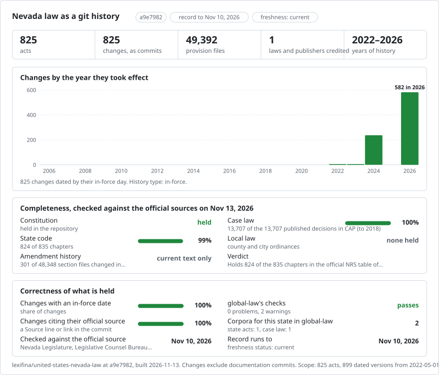

# United States (Nevada): law history in git

<picture>
<source media="(prefers-color-scheme: dark)" srcset="data/effort-dark.svg">

</picture>

Part of [lexifina/global-law](https://github.com/lexifina/global-law), one git history for every country's law: this is the law of Nevada, United States, which global-law reads at `united-states/nevada/acts/`.

A first build of Nevada law as git: one file per provision, with the text published by the Nevada Legislature (Legislative Counsel Bureau) ([leg.state.nv.us](https://www.leg.state.nv.us/NRS/)). It follows the shared design of [lexifina/global-law](https://github.com/lexifina/global-law), which places it at `united-states/nevada/`. Language: English.

**What is in it now**

| Folder | Law | Versions | History |
| --- | --- | ---: | --- |
| `constitution/` | Constitution of the State of Nevada (1864, as amended) | 1 | Oldest version available (retrieved 2026-07-13 or 2026-10-23 (the Internet Archive capture day of each page)) |
| `nrs-193/` | NRS chapter 193: Criminality Generally | 1 | Oldest version available (retrieved 2026-07-13 or 2026-10-23 (the Internet Archive capture day of each page)) |
| `nrs-200/` | NRS chapter 200: Crimes Against the Person | 1 | Oldest version available (retrieved 2026-07-13 or 2026-10-23 (the Internet Archive capture day of each page)) |
| `nrs-205/` | NRS chapter 205: Crimes Against Property | 1 | Oldest version available (retrieved 2026-07-13 or 2026-10-23 (the Internet Archive capture day of each page)) |
| `nrs-111/` | NRS chapter 111: Estates in Property | 1 | Oldest version available (retrieved 2026-07-13 or 2026-10-23 (the Internet Archive capture day of each page)) |
| `nrs-001/` | NRS chapter 1: Judicial department generally | 1 | Oldest version available, dated 2026-09-09 (93 sections) |
| `nrs-001a/` | NRS chapter 1A: Judicial retirement | 1 | Oldest version available, dated 2026-04-15 (72 sections) |
| `nrs-002/` | NRS chapter 2: Supreme court | 1 | Oldest version available, dated 2024-06-29 (59 sections) |
| `nrs-002a/` | NRS chapter 2A: Court of appeals | 1 | Oldest version available, dated 2026-04-15 (26 sections) |
| `nrs-003/` | NRS chapter 3: District courts | 1 | Oldest version available, dated 2026-04-15 (80 sections) |
| `nrs-004/` | NRS chapter 4: Justice courts | 1 | Oldest version available, dated 2026-04-15 (68 sections) |
| `nrs-005/` | NRS chapter 5: Municipal courts | 1 | Oldest version available, dated 2026-09-09 (28 sections) |
| `nrs-006/` | NRS chapter 6: Juries | 1 | Oldest version available, dated 2024-06-29 (19 sections) |
| `nrs-007/` | NRS chapter 7: Attorneys and counselors at law | 1 | Oldest version available, dated 2026-04-15 (24 sections) |
| `nrs-010/` | NRS chapter 10: General provisions | 1 | Oldest version available, dated 2026-04-15 (20 sections) |
| `nrs-011/` | NRS chapter 11: Limitation of actions | 1 | Oldest version available, dated 2026-04-15 (56 sections) |
| `nrs-012/` | NRS chapter 12: Parties | 1 | Oldest version available, dated 2024-06-29 (14 sections) |
| `nrs-013/` | NRS chapter 13: Place of trial | 1 | Oldest version available, dated 2026-04-15 (6 sections) |
| `nrs-014/` | NRS chapter 14: Commencement of actions | 1 | Oldest version available, dated 2026-04-15 (15 sections) |
| `nrs-015/` | NRS chapter 15: Pleadings, motions and orders | 1 | Oldest version available, dated 2024-06-29 (4 sections) |
| `nrs-016/` | NRS chapter 16: Date of trial; trial by jury; masters | 1 | Oldest version available, dated 2024-06-29 (21 sections) |
| `nrs-017/` | NRS chapter 17: Judgments | 1 | Oldest version available, dated 2026-04-15 (90 sections) |
| `nrs-018/` | NRS chapter 18: Costs and disbursements | 1 | Oldest version available, dated 2024-06-29 (19 sections) |
| `nrs-019/` | NRS chapter 19: Fees | 1 | Oldest version available, dated 2026-04-15 (26 sections) |
| `nrs-020/` | NRS chapter 20: Bonds and undertakings; deposits in lieu thereof | 1 | Oldest version available, dated 2026-04-15 (8 sections) |
| `nrs-021/` | NRS chapter 21: Enforcement of judgments | 1 | Oldest version available, dated 2024-06-29 (45 sections) |
| `nrs-022/` | NRS chapter 22: Contempts | 1 | Oldest version available, dated 2024-06-29 (14 sections) |
| `nrs-028/` | NRS chapter 28: General provisions | 1 | Oldest version available, dated 2024-06-29 (17 sections) |
| `nrs-029/` | NRS chapter 29: Submitting a controversy without action | 1 | Oldest version available, dated 2024-06-29 (3 sections) |
| `nrs-029a/` | NRS chapter 29A: Summary proceedings | 1 | Oldest version available, dated 2024-06-29 (9 sections) |
| `nrs-030/` | NRS chapter 30: Declaratory judgments | 1 | Oldest version available, dated 2026-04-15 (17 sections) |
| `nrs-031/` | NRS chapter 31: Attachment, garnishment and other extraordinary remedies | 1 | Oldest version available, dated 2026-04-15 (113 sections) |
| `nrs-031a/` | NRS chapter 31A: Enforcement of obligations for support of children | 1 | Oldest version available, dated 2024-06-29 (43 sections) |
| `nrs-032/` | NRS chapter 32: Receivers | 1 | Oldest version available, dated 2024-06-29 (53 sections) |
| `nrs-033/` | NRS chapter 33: Injunctions; protection orders | 1 | Oldest version available, dated 2026-09-09 (81 sections) |
| `nrs-034/` | NRS chapter 34: Writs; petition to establish factual innocence | 1 | Oldest version available, dated 2026-04-15 (99 sections) |
| `nrs-035/` | NRS chapter 35: Quo warranto | 1 | Oldest version available, dated 2026-04-15 (27 sections) |
| `nrs-036/` | NRS chapter 36: Provisional remedies on behalf of defendant | 1 | Oldest version available, dated 2024-06-29 (1 sections) |
| `nrs-037/` | NRS chapter 37: Eminent domain | 1 | Oldest version available, dated 2026-04-15 (45 sections) |
| `nrs-038/` | NRS chapter 38: Mediation and arbitration | 1 | Oldest version available, dated 2026-04-15 (85 sections) |
| `nrs-039/` | NRS chapter 39: Partition of real property and mining claims | 1 | Oldest version available, dated 2024-06-29 (78 sections) |
| `nrs-040/` | NRS chapter 40: Actions and proceedings in particular cases concerning property | 1 | Oldest version available, dated 2026-04-15 (151 sections) |
| `nrs-041/` | NRS chapter 41: Actions and proceedings in particular cases concerning persons | 1 | Oldest version available, dated 2026-04-15 (199 sections) |
| `nrs-041a/` | NRS chapter 41A: Actions for professional negligence | 1 | Oldest version available, dated 2026-04-15 (15 sections) |
| `nrs-041b/` | NRS chapter 41B: Action against killer of decedent for forfeiture of certain property, benefits and rights | 1 | Oldest version available, dated 2026-04-15 (27 sections) |
| `nrs-042/` | NRS chapter 42: Damages | 1 | Oldest version available, dated 2026-04-15 (47 sections) |
| `nrs-043/` | NRS chapter 43: Judicial confirmation | 1 | Oldest version available, dated 2024-06-29 (17 sections) |
| `nrs-047/` | NRS chapter 47: General provisions; judicial notice; presumptions | 1 | Oldest version available, dated 2024-06-29 (24 sections) |
| `nrs-048/` | NRS chapter 48: Admissibility generally | 1 | Oldest version available, dated 2026-04-15 (18 sections) |
| `nrs-049/` | NRS chapter 49: Privileges | 1 | Oldest version available, dated 2026-04-15 (76 sections) |
| `nrs-050/` | NRS chapter 50: Witnesses | 1 | Oldest version available, dated 2026-04-15 (64 sections) |
| `nrs-051/` | NRS chapter 51: Hearsay | 1 | Oldest version available, dated 2024-06-29 (38 sections) |
| `nrs-052/` | NRS chapter 52: Documentary and other physical evidence | 1 | Oldest version available, dated 2026-04-15 (53 sections) |
| `nrs-053/` | NRS chapter 53: Affidavits; foreign depositions | 1 | Oldest version available, dated 2026-04-15 (31 sections) |
| `nrs-054/` | NRS chapter 54: Corroborative proof of residence | 1 | Oldest version available, dated 2024-06-29 (1 sections) |
| `nrs-055/` | NRS chapter 55: Findings of presumed death | 1 | Oldest version available, dated 2024-06-29 (3 sections) |
| `nrs-056/` | NRS chapter 56: Tests of biological specimens | 1 | Oldest version available, dated 2024-06-29 (1 sections) |
| `nrs-062a/` | NRS chapter 62A: General provisions | 1 | Oldest version available, dated 2026-04-15 (42 sections) |
| `nrs-062b/` | NRS chapter 62B: General administration | 1 | Oldest version available, dated 2026-04-15 (60 sections) |
| `nrs-062c/` | NRS chapter 62C: Procedure before adjudication | 1 | Oldest version available, dated 2026-04-15 (27 sections) |
| `nrs-062d/` | NRS chapter 62D: Procedure in juvenile proceedings | 1 | Oldest version available, dated 2024-06-29 (34 sections) |
| `nrs-062e/` | NRS chapter 62E: Disposition of cases by juvenile court | 1 | Oldest version available, dated 2026-04-15 (63 sections) |
| `nrs-062f/` | NRS chapter 62F: Juvenile sex offenders | 1 | Oldest version available, dated 2026-04-15 (19 sections) |
| `nrs-062g/` | NRS chapter 62G: Administration of probation | 1 | Oldest version available, dated 2026-04-15 (40 sections) |
| `nrs-062h/` | NRS chapter 62H: Records related to children | 1 | Oldest version available, dated 2026-04-15 (23 sections) |
| `nrs-062i/` | NRS chapter 62I: Interstate compact for juveniles | 1 | Oldest version available, dated 2024-06-29 (2 sections) |
| `nrs-063/` | NRS chapter 63: State facilities for detention of children | 1 | Oldest version available, dated 2024-06-29 (59 sections) |
| `nrs-064/` | NRS chapter 64: General provisions | 1 | Oldest version available, dated 2024-06-29 (16 sections) |
| `nrs-065/` | NRS chapter 65: Parties | 1 | Oldest version available, dated 2024-06-29 (4 sections) |
| `nrs-066/` | NRS chapter 66: Place of trial | 1 | Oldest version available, dated 2024-06-29 (7 sections) |
| `nrs-067/` | NRS chapter 67: Trial by jury | 1 | Oldest version available, dated 2024-06-29 (6 sections) |
| `nrs-068/` | NRS chapter 68: Judgments | 1 | Oldest version available, dated 2026-04-15 (4 sections) |
| `nrs-069/` | NRS chapter 69: Costs | 1 | Oldest version available, dated 2024-06-29 (5 sections) |
| `nrs-070/` | NRS chapter 70: Executions | 1 | Oldest version available, dated 2024-06-29 (5 sections) |
| `nrs-071/` | NRS chapter 71: Provisional remedies | 1 | Oldest version available, dated 2024-06-29 (7 sections) |
| `nrs-072/` | NRS chapter 72: Bonds and undertakings | 1 | Oldest version available, dated 2024-06-29 (1 sections) |
| `nrs-073/` | NRS chapter 73: Small claims | 1 | Oldest version available, dated 2026-04-15 (8 sections) |
| `nrs-074/` | NRS chapter 74: Contempts | 1 | Oldest version available, dated 2024-06-29 (2 sections) |
| `nrs-075/` | NRS chapter 75: General provisions | 1 | Oldest version available, dated 2024-06-29 (13 sections) |
| `nrs-075a/` | NRS chapter 75A: State business portal | 1 | Oldest version available, dated 2026-04-15 (6 sections) |
| `nrs-076/` | NRS chapter 76: State business licenses | 1 | Oldest version available, dated 2026-04-15 (18 sections) |
| `nrs-077/` | NRS chapter 77: Model registered agents act | 1 | Oldest version available, dated 2026-04-15 (49 sections) |
| `nrs-078/` | NRS chapter 78: Private corporations | 1 | Oldest version available, dated 2026-04-15 (186 sections) |
| `nrs-078a/` | NRS chapter 78A: Close corporations | 1 | Oldest version available, dated 2026-04-15 (24 sections) |
| `nrs-078b/` | NRS chapter 78B: Benefit corporations | 1 | Oldest version available, dated 2026-04-15 (19 sections) |
| `nrs-080/` | NRS chapter 80: Foreign corporations | 1 | Oldest version available, dated 2026-04-15 (34 sections) |
| `nrs-081/` | NRS chapter 81: Miscellaneous organizations | 1 | Oldest version available, dated 2026-04-15 (129 sections) |
| `nrs-082/` | NRS chapter 82: Nonprofit corporations | 1 | Oldest version available, dated 2026-04-15 (106 sections) |
| `nrs-082a/` | NRS chapter 82A: Solicitation of contributions | 1 | Oldest version available, dated 2026-04-15 (20 sections) |
| `nrs-084/` | NRS chapter 84: Corporations sole | 1 | Oldest version available, dated 2026-04-15 (18 sections) |
| `nrs-086/` | NRS chapter 86: Limited-liability companies | 1 | Oldest version available, dated 2026-04-15 (139 sections) |
| `nrs-087/` | NRS chapter 87: Partnerships | 1 | Oldest version available, dated 2026-04-15 (136 sections) |
| `nrs-087a/` | NRS chapter 87A: Uniform limited partnership act (2001) | 1 | Oldest version available, dated 2024-06-29 (147 sections) |
| `nrs-088/` | NRS chapter 88: Uniform limited partnership act | 1 | Oldest version available, dated 2024-06-29 (109 sections) |
| `nrs-088a/` | NRS chapter 88A: Business trusts | 1 | Oldest version available, dated 2026-04-15 (70 sections) |
| `nrs-089/` | NRS chapter 89: Professional entities and associations | 1 | Oldest version available, dated 2026-04-15 (31 sections) |
| `nrs-090/` | NRS chapter 90: Securities (uniform act) | 1 | Oldest version available, dated 2026-04-15 (122 sections) |
| `nrs-091/` | NRS chapter 91: Commodities | 1 | Oldest version available, dated 2026-04-15 (34 sections) |
| `nrs-092a/` | NRS chapter 92A: Mergers, conversions, exchanges and domestications | 1 | Oldest version available, dated 2024-06-29 (83 sections) |
| `nrs-097/` | NRS chapter 97: Retail installment sales of goods and services | 1 | Oldest version available, dated 2026-04-15 (36 sections) |
| `nrs-097a/` | NRS chapter 97A: Debt evidenced by credit card | 1 | Oldest version available, dated 2024-06-29 (23 sections) |
| `nrs-097b/` | NRS chapter 97B: Consumer protection from predatory interest | 1 | Oldest version available, dated 2026-04-15 (17 sections) |
| `nrs-099/` | NRS chapter 99: Money of account and interest; legal investments | 1 | Oldest version available, dated 2026-04-15 (10 sections) |
| `nrs-100/` | NRS chapter 100: Special relations of debtor and creditor; suretyship | 1 | Oldest version available, dated 2026-04-15 (28 sections) |
| `nrs-101/` | NRS chapter 101: Joint obligations (uniform act) | 1 | Oldest version available, dated 2024-06-29 (9 sections) |
| `nrs-102/` | NRS chapter 102: Interparty agreements (uniform act) | 1 | Oldest version available, dated 2024-06-29 (6 sections) |
| `nrs-104a/` | NRS chapter 104A: Uniform commercial code-additional articles | 1 | Oldest version available, dated 2026-04-15 (119 sections) |
| `nrs-104b/` | NRS chapter 104B: Uniform commercial code-article 12-controllable electronic records | 1 | Oldest version available, dated 2024-06-29 (7 sections) |
| `nrs-104c/` | NRS chapter 104C: Uniform commercial code-article a-transitional provisions for uniform commercial code amendments (2022) | 1 | Oldest version available, dated 2026-04-15 (9 sections) |
| `nrs-105/` | NRS chapter 105: Security instruments of public utilities | 1 | Oldest version available, dated 2026-04-15 (8 sections) |
| `nrs-106/` | NRS chapter 106: Real mortgages | 1 | Oldest version available, dated 2024-06-29 (28 sections) |
| `nrs-106a/` | NRS chapter 106A: Mortgage modifications (uniform act) | 1 | Oldest version available, dated 2026-04-15 (16 sections) |
| `nrs-107/` | NRS chapter 107: Deeds of trust | 1 | Oldest version available, dated 2024-06-29 (61 sections) |
| `nrs-107a/` | NRS chapter 107A: Assignment of rents (uniform act) | 1 | Oldest version available, dated 2024-06-29 (37 sections) |
| `nrs-108/` | NRS chapter 108: Statutory liens | 1 | Oldest version available, dated 2026-04-15 (195 sections) |
| `nrs-111a/` | NRS chapter 111A: Easement relocation (uniform act) | 1 | Oldest version available, dated 2026-04-15 (32 sections) |
| `nrs-112/` | NRS chapter 112: Fraudulent transfers (uniform act) | 1 | Oldest version available, dated 2024-06-29 (12 sections) |
| `nrs-113/` | NRS chapter 113: Sales of real property | 1 | Oldest version available, dated 2026-04-15 (17 sections) |
| `nrs-115/` | NRS chapter 115: Homesteads | 1 | Oldest version available, dated 2026-04-15 (12 sections) |
| `nrs-116/` | NRS chapter 116: Common-interest ownership (uniform act) | 1 | Oldest version available, dated 2026-04-15 (235 sections) |
| `nrs-116b/` | NRS chapter 116B: Condominium hotel act | 1 | Oldest version available, dated 2026-04-15 (187 sections) |
| `nrs-117/` | NRS chapter 117: Condominiums | 1 | Oldest version available, dated 2026-04-15 (15 sections) |
| `nrs-118/` | NRS chapter 118: Discrimination in housing; landlord and tenant | 1 | Oldest version available, dated 2026-04-15 (25 sections) |
| `nrs-118a/` | NRS chapter 118A: Landlord and tenant: dwellings | 1 | Oldest version available, dated 2026-04-15 (76 sections) |
| `nrs-118b/` | NRS chapter 118B: Landlord and tenant: manufactured home parks | 1 | Oldest version available, dated 2026-04-15 (90 sections) |
| `nrs-118c/` | NRS chapter 118C: Landlord and tenant: commercial premises | 1 | Oldest version available, dated 2026-04-15 (15 sections) |
| `nrs-119/` | NRS chapter 119: Sale of subdivided land: licensing and regulation | 1 | Oldest version available, dated 2026-04-15 (68 sections) |
| `nrs-119a/` | NRS chapter 119A: Time shares | 1 | Oldest version available, dated 2026-04-15 (140 sections) |
| `nrs-119b/` | NRS chapter 119B: Memberships in campgrounds | 1 | Oldest version available, dated 2026-04-15 (52 sections) |
| `nrs-120/` | NRS chapter 120: Disclaimer of property interests (uniform act) | 1 | Oldest version available, dated 2024-06-29 (26 sections) |
| `nrs-120a/` | NRS chapter 120A: Unclaimed property (uniform act) | 1 | Oldest version available, dated 2026-04-15 (59 sections) |
| `nrs-121/` | NRS chapter 121: General provisions | 1 | Oldest version available, dated 2026-04-15 (3 sections) |
| `nrs-122/` | NRS chapter 122: Marriage | 1 | Oldest version available, dated 2026-04-15 (61 sections) |
| `nrs-122a/` | NRS chapter 122A: Domestic partnerships | 1 | Oldest version available, dated 2026-04-15 (12 sections) |
| `nrs-123/` | NRS chapter 123: Rights of married couples | 1 | Oldest version available, dated 2024-06-29 (30 sections) |
| `nrs-123a/` | NRS chapter 123A: Premarital agreements (uniform act) | 1 | Oldest version available, dated 2026-04-15 (10 sections) |
| `nrs-125/` | NRS chapter 125: Dissolution of marriage | 1 | Oldest version available, dated 2026-04-15 (56 sections) |
| `nrs-125a/` | NRS chapter 125A: Uniform child custody jurisdiction and enforcement act | 1 | Oldest version available, dated 2026-04-15 (58 sections) |
| `nrs-125b/` | NRS chapter 125B: Obligation of support | 1 | Oldest version available, dated 2026-04-15 (38 sections) |
| `nrs-125c/` | NRS chapter 125C: Custody and visitation | 1 | Oldest version available, dated 2026-04-15 (84 sections) |
| `nrs-125d/` | NRS chapter 125D: Uniform child abduction prevention act | 1 | Oldest version available, dated 2026-04-15 (23 sections) |
| `nrs-125e/` | NRS chapter 125E: Custody of indian children | 1 | Oldest version available, dated 2026-04-15 (37 sections) |
| `nrs-126/` | NRS chapter 126: Parentage | 1 | Oldest version available, dated 2026-04-15 (67 sections) |
| `nrs-127/` | NRS chapter 127: Adoption of children and adults | 1 | Oldest version available, dated 2026-04-15 (85 sections) |
| `nrs-127a/` | NRS chapter 127A: Adoption generally | 1 | Oldest version available, dated 2026-04-15 (45 sections) |
| `nrs-127b/` | NRS chapter 127B: Adoption of children in custody of agency which provides child welfare services | 1 | Oldest version available, dated 2026-04-15 (57 sections) |
| `nrs-127c/` | NRS chapter 127C: Agency adoptions, identified adoptions and adult adoptions | 1 | Oldest version available, dated 2026-04-15 (65 sections) |
| `nrs-127d/` | NRS chapter 127D: Close-family adoptions | 1 | Oldest version available, dated 2026-04-15 (39 sections) |
| `nrs-127e/` | NRS chapter 127E: Confirmatory adoptions and readoptions | 1 | Oldest version available, dated 2026-04-15 (8 sections) |
| `nrs-127f/` | NRS chapter 127F: Interstate compact on the | 1 | Oldest version available, dated 2026-04-15 (5 sections) |
| `nrs-127g/` | NRS chapter 127G: Interstate compact on adoption | 1 | Oldest version available, dated 2026-04-15 (3 sections) |
| `nrs-128/` | NRS chapter 128: Termination of parental rights | 1 | Oldest version available, dated 2026-04-15 (48 sections) |
| `nrs-129/` | NRS chapter 129: Minors' disabilities; judicial emancipation of minors | 1 | Oldest version available, dated 2026-09-09 (13 sections) |
| `nrs-130/` | NRS chapter 130: Interjurisdictional enforcement of support | 1 | Oldest version available, dated 2026-04-15 (116 sections) |
| `nrs-132/` | NRS chapter 132: General provisions | 1 | Oldest version available, dated 2026-04-15 (85 sections) |
| `nrs-133/` | NRS chapter 133: Wills | 1 | Oldest version available, dated 2026-04-15 (34 sections) |
| `nrs-133a/` | NRS chapter 133A: International wills (uniform act) | 1 | Oldest version available, dated 2024-06-29 (12 sections) |
| `nrs-134/` | NRS chapter 134: Succession | 1 | Oldest version available, dated 2026-04-15 (17 sections) |
| `nrs-135/` | NRS chapter 135: Simultaneous death (uniform act) | 1 | Oldest version available, dated 2024-06-29 (8 sections) |
| `nrs-136/` | NRS chapter 136: Probate of wills and petitions for letters | 1 | Oldest version available, dated 2026-04-15 (26 sections) |
| `nrs-137/` | NRS chapter 137: Contests of wills | 1 | Oldest version available, dated 2024-06-29 (16 sections) |
| `nrs-138/` | NRS chapter 138: Appointment of personal representatives | 1 | Oldest version available, dated 2026-04-15 (9 sections) |
| `nrs-139/` | NRS chapter 139: Appointment of administrators | 1 | Oldest version available, dated 2026-04-15 (17 sections) |
| `nrs-140/` | NRS chapter 140: Special administrators | 1 | Oldest version available, dated 2026-04-15 (8 sections) |
| `nrs-141/` | NRS chapter 141: Letters generally; changes in administration | 1 | Oldest version available, dated 2024-06-29 (16 sections) |
| `nrs-142/` | NRS chapter 142: Oaths and bonds | 1 | Oldest version available, dated 2024-06-29 (15 sections) |
| `nrs-143/` | NRS chapter 143: Powers and duties of personal representatives | 1 | Oldest version available, dated 2024-06-29 (99 sections) |
| `nrs-144/` | NRS chapter 144: Inventory and appraisement | 1 | Oldest version available, dated 2026-04-15 (10 sections) |
| `nrs-145/` | NRS chapter 145: Summary administration of estates | 1 | Oldest version available, dated 2026-04-15 (9 sections) |
| `nrs-146/` | NRS chapter 146: Support of family; small estates | 1 | Oldest version available, dated 2026-04-15 (9 sections) |
| `nrs-147/` | NRS chapter 147: Presentation and payment of claims | 1 | Oldest version available, dated 2026-04-15 (24 sections) |
| `nrs-148/` | NRS chapter 148: Sales, conveyances and exchanges | 1 | Oldest version available, dated 2024-06-29 (44 sections) |
| `nrs-149/` | NRS chapter 149: Notes, mortgages and leases | 1 | Oldest version available, dated 2024-06-29 (10 sections) |
| `nrs-150/` | NRS chapter 150: Compensation and accounting | 1 | Oldest version available, dated 2026-04-15 (47 sections) |
| `nrs-151/` | NRS chapter 151: Adjustments; distribution and discharge | 1 | Oldest version available, dated 2026-04-15 (31 sections) |
| `nrs-152/` | NRS chapter 152: Partition before discharge | 1 | Oldest version available, dated 2024-06-29 (17 sections) |
| `nrs-153/` | NRS chapter 153: Administration of trusts; estates for life and years | 1 | Oldest version available, dated 2024-06-29 (12 sections) |
| `nrs-154/` | NRS chapter 154: Escheats | 1 | Oldest version available, dated 2024-06-29 (19 sections) |
| `nrs-155/` | NRS chapter 155: Notices, transfers, orders, procedure and appeals | 1 | Oldest version available, dated 2026-04-15 (41 sections) |
| `nrs-156/` | NRS chapter 156: Administration of estates of missing persons | 1 | Oldest version available, dated 2024-06-29 (26 sections) |
| `nrs-158/` | NRS chapter 158: General provisions | 1 | Oldest version available, dated 2024-06-29 (3 sections) |
| `nrs-159/` | NRS chapter 159: Guardianship of adults | 1 | Oldest version available, dated 2026-04-15 (203 sections) |
| `nrs-159a/` | NRS chapter 159A: Guardianship of minors | 1 | Oldest version available, dated 2026-04-15 (177 sections) |
| `nrs-160/` | NRS chapter 160: Veterans' guardianship (uniform act) | 1 | Oldest version available, dated 2024-06-29 (21 sections) |
| `nrs-161/` | NRS chapter 161: Conservators for members of the armed forces and merchant seamen | 1 | Oldest version available, dated 2024-06-29 (3 sections) |
| `nrs-162/` | NRS chapter 162: Fiduciaries | 1 | Oldest version available, dated 2026-04-15 (27 sections) |
| `nrs-162a/` | NRS chapter 162A: Power of attorney for financial matters and durable power of attorney for health care decisions | 1 | Oldest version available, dated 2026-04-15 (83 sections) |
| `nrs-162b/` | NRS chapter 162B: Powers of appointment (uniform act) | 1 | Oldest version available, dated 2024-06-29 (56 sections) |
| `nrs-162c/` | NRS chapter 162C: Supported decision-making act | 1 | Oldest version available, dated 2024-06-29 (20 sections) |
| `nrs-163/` | NRS chapter 163: Trusts | 1 | Oldest version available, dated 2026-04-15 (148 sections) |
| `nrs-164/` | NRS chapter 164: Administration of trusts | 1 | Oldest version available, dated 2026-04-15 (96 sections) |
| `nrs-165/` | NRS chapter 165: Trustees' accounting (uniform act) | 1 | Oldest version available, dated 2024-06-29 (25 sections) |
| `nrs-166/` | NRS chapter 166: Spendthrift trusts | 1 | Oldest version available, dated 2026-04-15 (21 sections) |
| `nrs-166a/` | NRS chapter 166A: Custodial trusts (uniform act) | 1 | Oldest version available, dated 2024-06-29 (36 sections) |
| `nrs-167/` | NRS chapter 167: Transfers to minors (uniform act) | 1 | Oldest version available, dated 2024-06-29 (23 sections) |
| `nrs-169/` | NRS chapter 169: Preliminary provisions | 1 | Oldest version available, dated 2026-04-15 (28 sections) |
| `nrs-170/` | NRS chapter 170: Prevention of public offenses | 1 | Oldest version available, dated 2024-06-29 (13 sections) |
| `nrs-171/` | NRS chapter 171: Proceedings to commitment | 1 | Oldest version available, dated 2026-04-15 (111 sections) |
| `nrs-172/` | NRS chapter 172: Proceedings after commitment and before indictment | 1 | Oldest version available, dated 2026-04-15 (42 sections) |
| `nrs-173/` | NRS chapter 173: Indictment and information | 1 | Oldest version available, dated 2024-06-29 (21 sections) |
| `nrs-174/` | NRS chapter 174: Arraignment and preparation for trial | 1 | Oldest version available, dated 2026-04-15 (63 sections) |
| `nrs-175/` | NRS chapter 175: Trial | 1 | Oldest version available, dated 2026-04-15 (62 sections) |
| `nrs-176/` | NRS chapter 176: Judgment and execution | 1 | Oldest version available, dated 2026-04-15 (136 sections) |
| `nrs-176a/` | NRS chapter 176A: Probation and suspension of sentence | 1 | Oldest version available, dated 2026-04-15 (68 sections) |
| `nrs-177/` | NRS chapter 177: Appeals and remedies after conviction | 1 | Oldest version available, dated 2024-07-10 (25 sections) |
| `nrs-178/` | NRS chapter 178: General provisions | 1 | Oldest version available, dated 2026-04-15 (127 sections) |
| `nrs-178a/` | NRS chapter 178A: Sexual assault survivors' bill of rights | 1 | Oldest version available, dated 2026-04-15 (35 sections) |
| `nrs-179/` | NRS chapter 179: Special proceedings of a criminal nature; sealing records of criminal proceedings; rewards; forms | 1 | Oldest version available, dated 2026-04-15 (161 sections) |
| `nrs-179a/` | NRS chapter 179A: Records of criminal history and information relating to public safety | 1 | Oldest version available, dated 2026-04-15 (44 sections) |
| `nrs-179b/` | NRS chapter 179B: Statewide registry of sex offenders and offenders convicted of a crime against a child | 1 | Oldest version available, dated 2026-04-15 (23 sections) |
| `nrs-179c/` | NRS chapter 179C: Registration of convicted persons | 1 | Oldest version available, dated 2024-06-29 (9 sections) |
| `nrs-179d/` | NRS chapter 179D: Registration of sex offenders and offenders convicted of a crime against a child | 1 | Oldest version available, dated 2026-04-15 (41 sections) |
| `nrs-180/` | NRS chapter 180: Indigent defense services | 1 | Oldest version available, dated 2026-04-15 (29 sections) |
| `nrs-189/` | NRS chapter 189: Justice courts | 1 | Oldest version available, dated 2024-06-29 (11 sections) |
| `nrs-194/` | NRS chapter 194: Persons liable to punishment for crime | 1 | Oldest version available, dated 2024-06-29 (3 sections) |
| `nrs-195/` | NRS chapter 195: Parties to crimes | 1 | Oldest version available, dated 2026-04-15 (4 sections) |
| `nrs-196/` | NRS chapter 196: Crimes against the sovereignty of this state | 1 | Oldest version available, dated 2024-06-29 (3 sections) |
| `nrs-197/` | NRS chapter 197: Crimes by and against the executive power of this state | 1 | Oldest version available, dated 2026-04-15 (23 sections) |
| `nrs-198/` | NRS chapter 198: Crimes against the legislative power | 1 | Oldest version available, dated 2024-06-29 (1 sections) |
| `nrs-199/` | NRS chapter 199: Crimes against public justice | 1 | Oldest version available, dated 2026-04-15 (55 sections) |
| `nrs-201/` | NRS chapter 201: Crimes against public decency and good morals | 1 | Oldest version available, dated 2026-04-15 (85 sections) |
| `nrs-202/` | NRS chapter 202: Crimes against public health and safety | 1 | Oldest version available, dated 2026-04-15 (152 sections) |
| `nrs-203/` | NRS chapter 203: Crimes against the public peace | 1 | Oldest version available, dated 2026-04-15 (14 sections) |
| `nrs-204/` | NRS chapter 204: Crimes against the revenue and property of this state | 1 | Oldest version available, dated 2024-06-29 (8 sections) |
| `nrs-205a/` | NRS chapter 205A: Technological crime advisory board | 1 | Oldest version available, dated 2026-04-15 (10 sections) |
| `nrs-206/` | NRS chapter 206: Malicious mischief | 1 | Oldest version available, dated 2026-04-15 (25 sections) |
| `nrs-207/` | NRS chapter 207: Miscellaneous crimes | 1 | Oldest version available, dated 2026-04-15 (70 sections) |
| `nrs-208/` | NRS chapter 208: General provisions | 1 | Oldest version available, dated 2026-04-15 (18 sections) |
| `nrs-209/` | NRS chapter 209: Department of corrections | 1 | Oldest version available, dated 2026-04-15 (186 sections) |
| `nrs-211/` | NRS chapter 211: Local facilities for detention | 1 | Oldest version available, dated 2026-04-15 (61 sections) |
| `nrs-211a/` | NRS chapter 211A: Department of alternative sentencing | 1 | Oldest version available, dated 2026-04-15 (17 sections) |
| `nrs-212/` | NRS chapter 212: Offenses relating to prisons and prisoners | 1 | Oldest version available, dated 2026-04-15 (31 sections) |
| `nrs-213/` | NRS chapter 213: Pardons and paroles; remissions of fines and commutations of punishments | 1 | Oldest version available, dated 2026-04-15 (133 sections) |
| `nrs-215a/` | NRS chapter 215A: Interstate corrections compact | 1 | Oldest version available, dated 2024-06-29 (6 sections) |
| `nrs-217/` | NRS chapter 217: Aid to certain victims of crime | 1 | Oldest version available, dated 2026-04-15 (79 sections) |
| `nrs-218a/` | NRS chapter 218A: Legislative department generally | 1 | Oldest version available, dated 2026-04-15 (92 sections) |
| `nrs-218b/` | NRS chapter 218B: Legislative districts | 1 | Oldest version available, dated 2026-04-16 (13 sections) |
| `nrs-218c/` | NRS chapter 218C: Legislators' retirement | 1 | Oldest version available, dated 2024-06-29 (36 sections) |
| `nrs-218d/` | NRS chapter 218D: Legislative measures and procedures | 1 | Oldest version available, dated 2026-09-09 (80 sections) |
| `nrs-218e/` | NRS chapter 218E: Legislative investigations and hearings; legislative commission and other committees | 1 | Oldest version available, dated 2026-04-15 (67 sections) |
| `nrs-218f/` | NRS chapter 218F: Legislative counsel bureau | 1 | Oldest version available, dated 2026-04-15 (31 sections) |
| `nrs-218g/` | NRS chapter 218G: Legislative audits | 1 | Oldest version available, dated 2026-04-15 (46 sections) |
| `nrs-218h/` | NRS chapter 218H: Lobbying | 1 | Oldest version available, dated 2026-04-15 (36 sections) |
| `nrs-219/` | NRS chapter 219: Commissioners on uniform state laws | 1 | Oldest version available, dated 2024-06-29 (6 sections) |
| `nrs-219a/` | NRS chapter 219A: Nevada youth legislature | 1 | Oldest version available, dated 2024-06-29 (17 sections) |
| `nrs-220/` | NRS chapter 220: Revision of statutes | 1 | Oldest version available, dated 2024-06-29 (16 sections) |
| `nrs-223/` | NRS chapter 223: Governor | 1 | Oldest version available, dated 2026-09-09 (71 sections) |
| `nrs-224/` | NRS chapter 224: Lieutenant governor | 1 | Oldest version available, dated 2026-04-15 (22 sections) |
| `nrs-225/` | NRS chapter 225: Secretary of state | 1 | Oldest version available, dated 2026-04-15 (51 sections) |
| `nrs-226/` | NRS chapter 226: State treasurer | 1 | Oldest version available, dated 2026-09-09 (93 sections) |
| `nrs-227/` | NRS chapter 227: State controller | 1 | Oldest version available, dated 2026-04-15 (30 sections) |
| `nrs-228/` | NRS chapter 228: Attorney general | 1 | Oldest version available, dated 2026-04-15 (116 sections) |
| `nrs-231/` | NRS chapter 231: Economic development, tourism and cultural affairs | 1 | Oldest version available, dated 2026-04-15 (166 sections) |
| `nrs-231a/` | NRS chapter 231A: Nevada new markets jobs act | 1 | Oldest version available, dated 2024-12-09 (41 sections) |
| `nrs-232/` | NRS chapter 232: State departments | 1 | Oldest version available, dated 2026-04-15 (218 sections) |
| `nrs-232a/` | NRS chapter 232A: Appointments by the governor to public bodies | 1 | Oldest version available, dated 2026-04-15 (4 sections) |
| `nrs-232b/` | NRS chapter 232B: Legislative review of public agencies | 1 | Oldest version available, dated 2026-04-15 (17 sections) |
| `nrs-233/` | NRS chapter 233: Nevada equal rights commission | 1 | Oldest version available, dated 2026-04-15 (28 sections) |
| `nrs-233a/` | NRS chapter 233A: Indian affairs | 1 | Oldest version available, dated 2026-04-15 (59 sections) |
| `nrs-233b/` | NRS chapter 233B: Nevada administrative procedure act | 1 | Oldest version available, dated 2026-09-09 (66 sections) |
| `nrs-233c/` | NRS chapter 233C: Organizations for the promotion of culture | 1 | Oldest version available, dated 2026-04-15 (19 sections) |
| `nrs-233f/` | NRS chapter 233F: State system of communications | 1 | Oldest version available, dated 2024-06-29 (24 sections) |
| `nrs-233g/` | NRS chapter 233G: Governor's advisory council on education relating to the holocaust | 1 | Oldest version available, dated 2026-04-15 (4 sections) |
| `nrs-233i/` | NRS chapter 233I: Nevada commission for women | 1 | Oldest version available, dated 2026-04-15 (9 sections) |
| `nrs-234/` | NRS chapter 234: State and local governmental boundaries | 1 | Oldest version available, dated 2026-04-15 (8 sections) |
| `nrs-235/` | NRS chapter 235: State seal, motto and symbols; gifts and endowments | 1 | Oldest version available, dated 2026-04-16 (30 sections) |
| `nrs-236/` | NRS chapter 236: Holidays and periods of observance | 1 | Oldest version available, dated 2026-04-15 (30 sections) |
| `nrs-237/` | NRS chapter 237: Miscellaneous provisions applicable to governmental entities | 1 | Oldest version available, dated 2026-04-15 (20 sections) |
| `nrs-237a/` | NRS chapter 237A: Foreign trade zones and trade districts | 1 | Oldest version available, dated 2024-06-29 (7 sections) |
| `nrs-238/` | NRS chapter 238: Legal notices and advertisements | 1 | Oldest version available, dated 2026-04-15 (10 sections) |
| `nrs-239/` | NRS chapter 239: Public records | 1 | Oldest version available, dated 2026-04-15 (54 sections) |
| `nrs-239a/` | NRS chapter 239A: Disclosure of financial information to governmental agencies | 1 | Oldest version available, dated 2026-04-15 (21 sections) |
| `nrs-239b/` | NRS chapter 239B: Disclosure of personal information to governmental agencies | 1 | Oldest version available, dated 2026-04-15 (11 sections) |
| `nrs-239c/` | NRS chapter 239C: Homeland security | 1 | Oldest version available, dated 2026-04-15 (43 sections) |
| `nrs-240/` | NRS chapter 240: Notaries public and commissioned abstracters | 1 | Oldest version available, dated 2026-04-15 (102 sections) |
| `nrs-240a/` | NRS chapter 240A: Document preparation services | 1 | Oldest version available, dated 2026-04-15 (38 sections) |
| `nrs-241/` | NRS chapter 241: Meetings of state and local agencies | 1 | Oldest version available, dated 2026-04-15 (26 sections) |
| `nrs-241a/` | NRS chapter 241A: Advisory council for prosecuting attorneys | 1 | Oldest version available, dated 2026-04-15 (9 sections) |
| `nrs-242/` | NRS chapter 242: Information services | 1 | Oldest version available, dated 2026-04-15 (58 sections) |
| `nrs-243/` | NRS chapter 243: Counties: creation; boundaries; seats; abolishment | 1 | Oldest version available, dated 2024-06-29 (95 sections) |
| `nrs-244/` | NRS chapter 244: Counties: government | 1 | Oldest version available, dated 2026-04-15 (335 sections) |
| `nrs-244a/` | NRS chapter 244A: Counties: financing of public improvements | 1 | Oldest version available, dated 2026-04-15 (226 sections) |
| `nrs-245/` | NRS chapter 245: Counties: officers and employees generally | 1 | Oldest version available, dated 2026-04-15 (36 sections) |
| `nrs-246/` | NRS chapter 246: County clerks | 1 | Oldest version available, dated 2024-06-29 (19 sections) |
| `nrs-247/` | NRS chapter 247: County recorders | 1 | Oldest version available, dated 2026-04-15 (48 sections) |
| `nrs-248/` | NRS chapter 248: Sheriffs | 1 | Oldest version available, dated 2026-04-15 (39 sections) |
| `nrs-249/` | NRS chapter 249: County treasurers | 1 | Oldest version available, dated 2024-06-29 (17 sections) |
| `nrs-250/` | NRS chapter 250: County assessors | 1 | Oldest version available, dated 2026-04-15 (26 sections) |
| `nrs-251/` | NRS chapter 251: County auditors and comptrollers | 1 | Oldest version available, dated 2024-06-29 (6 sections) |
| `nrs-252/` | NRS chapter 252: District attorneys | 1 | Oldest version available, dated 2026-04-15 (18 sections) |
| `nrs-253/` | NRS chapter 253: Public administration of estates and public guardians | 1 | Oldest version available, dated 2026-04-15 (35 sections) |
| `nrs-254/` | NRS chapter 254: County engineers | 1 | Oldest version available, dated 2026-04-15 (5 sections) |
| `nrs-255/` | NRS chapter 255: County surveyors | 1 | Oldest version available, dated 2026-04-15 (14 sections) |
| `nrs-257/` | NRS chapter 257: Townships | 1 | Oldest version available, dated 2024-06-29 (1 sections) |
| `nrs-258/` | NRS chapter 258: Constables | 1 | Oldest version available, dated 2026-04-15 (34 sections) |
| `nrs-259/` | NRS chapter 259: Coroners | 1 | Oldest version available, dated 2026-04-15 (24 sections) |
| `nrs-260/` | NRS chapter 260: County public defenders | 1 | Oldest version available, dated 2024-06-29 (9 sections) |
| `nrs-265/` | NRS chapter 265: Incorporation and disincorporation of cities and towns | 1 | Oldest version available, dated 2026-04-15 (17 sections) |
| `nrs-266/` | NRS chapter 266: General law for incorporation of cities and towns | 1 | Oldest version available, dated 2026-04-15 (147 sections) |
| `nrs-267/` | NRS chapter 267: Commission form of municipal government | 1 | Oldest version available, dated 2026-04-15 (32 sections) |
| `nrs-268/` | NRS chapter 268: Powers and duties common to cities and towns incorporated under general or special laws | 1 | Oldest version available, dated 2026-09-09 (405 sections) |
| `nrs-269/` | NRS chapter 269: Unincorporated towns | 1 | Oldest version available, dated 2026-09-09 (137 sections) |
| `nrs-270/` | NRS chapter 270: Correction and vacation of plats | 1 | Oldest version available, dated 2024-06-29 (18 sections) |
| `nrs-270a/` | NRS chapter 270A: Joint municipal organizations | 1 | Oldest version available, dated 2026-04-15 (4 sections) |
| `nrs-270b/` | NRS chapter 270B: Foreign municipal corporations | 1 | Oldest version available, dated 2026-04-15 (6 sections) |
| `nrs-271/` | NRS chapter 271: Local improvements | 1 | Oldest version available, dated 2026-04-15 (230 sections) |
| `nrs-271a/` | NRS chapter 271A: Tourism improvements | 1 | Oldest version available, dated 2026-04-15 (17 sections) |
| `nrs-271b/` | NRS chapter 271B: Economic diversification | 1 | Oldest version available, dated 2026-04-15 (13 sections) |
| `nrs-274/` | NRS chapter 274: Zones for economic development | 1 | Oldest version available, dated 2024-06-29 (33 sections) |
| `nrs-277/` | NRS chapter 277: Cooperative agreements: state, counties, cities, districts and other public agencies | 1 | Oldest version available, dated 2026-04-15 (51 sections) |
| `nrs-277a/` | NRS chapter 277A: Regional transportation commissions | 1 | Oldest version available, dated 2024-06-29 (53 sections) |
| `nrs-277b/` | NRS chapter 277B: Inland port authority act | 1 | Oldest version available, dated 2024-06-29 (29 sections) |
| `nrs-278/` | NRS chapter 278: Planning and zoning | 1 | Oldest version available, dated 2026-09-09 (328 sections) |
| `nrs-278a/` | NRS chapter 278A: Planned development | 1 | Oldest version available, dated 2024-06-29 (55 sections) |
| `nrs-278b/` | NRS chapter 278B: Impact fees for new development | 1 | Oldest version available, dated 2024-06-29 (37 sections) |
| `nrs-278c/` | NRS chapter 278C: Tax increment areas | 1 | Oldest version available, dated 2024-06-29 (38 sections) |
| `nrs-279/` | NRS chapter 279: Redevelopment of communities | 1 | Oldest version available, dated 2026-04-15 (157 sections) |
| `nrs-279a/` | NRS chapter 279A: Rehabilitation of property in residential neighborhoods | 1 | Oldest version available, dated 2024-06-29 (11 sections) |
| `nrs-279b/` | NRS chapter 279B: Rehabilitation of abandoned residential property | 1 | Oldest version available, dated 2026-04-15 (10 sections) |
| `nrs-280/` | NRS chapter 280: Metropolitan police departments | 1 | Oldest version available, dated 2026-04-15 (53 sections) |
| `nrs-281/` | NRS chapter 281: General provisions | 1 | Oldest version available, dated 2026-04-15 (105 sections) |
| `nrs-281a/` | NRS chapter 281A: Ethics in government | 1 | Oldest version available, dated 2026-04-15 (85 sections) |
| `nrs-282/` | NRS chapter 282: Official bonds and oaths | 1 | Oldest version available, dated 2024-06-29 (30 sections) |
| `nrs-283/` | NRS chapter 283: Resignations, vacancies and removals | 1 | Oldest version available, dated 2026-04-15 (46 sections) |
| `nrs-284/` | NRS chapter 284: State human resources system | 1 | Oldest version available, dated 2026-04-15 (143 sections) |
| `nrs-285/` | NRS chapter 285: Awards to state employees | 1 | Oldest version available, dated 2026-04-15 (13 sections) |
| `nrs-286/` | NRS chapter 286: Public employees' retirement | 1 | Oldest version available, dated 2026-04-15 (165 sections) |
| `nrs-287/` | NRS chapter 287: Programs for public employees | 1 | Oldest version available, dated 2026-04-15 (120 sections) |
| `nrs-288/` | NRS chapter 288: Relations between governments and public employees | 1 | Oldest version available, dated 2026-04-15 (89 sections) |
| `nrs-289/` | NRS chapter 289: Peace officers and other law enforcement personnel | 1 | Oldest version available, dated 2026-04-15 (82 sections) |
| `nrs-293/` | NRS chapter 293: Elections | 1 | Oldest version available, dated 2026-09-09 (416 sections) |
| `nrs-293b/` | NRS chapter 293B: Mechanical voting systems or devices | 1 | Oldest version available, dated 2026-04-15 (80 sections) |
| `nrs-293c/` | NRS chapter 293C: City elections | 1 | Oldest version available, dated 2026-04-15 (121 sections) |
| `nrs-293d/` | NRS chapter 293D: Uniformed military and overseas absentee voters act | 1 | Oldest version available, dated 2026-04-15 (30 sections) |
| `nrs-294a/` | NRS chapter 294A: Campaign practices | 1 | Oldest version available, dated 2026-04-15 (71 sections) |
| `nrs-295/` | NRS chapter 295: Certain state and local ballot questions | 1 | Oldest version available, dated 2026-04-15 (37 sections) |
| `nrs-298/` | NRS chapter 298: Presidential electors and elections | 1 | Oldest version available, dated 2026-04-15 (27 sections) |
| `nrs-304/` | NRS chapter 304: Election of united states senators and representatives | 1 | Oldest version available, dated 2026-04-16 (13 sections) |
| `nrs-306/` | NRS chapter 306: Recall of public officers | 1 | Oldest version available, dated 2026-04-15 (18 sections) |
| `nrs-308/` | NRS chapter 308: Control of special districts | 1 | Oldest version available, dated 2026-04-15 (8 sections) |
| `nrs-315/` | NRS chapter 315: Housing authorities | 1 | Oldest version available, dated 2026-04-15 (157 sections) |
| `nrs-318/` | NRS chapter 318: General improvement districts | 1 | Oldest version available, dated 2026-04-15 (122 sections) |
| `nrs-318a/` | NRS chapter 318A: Parks, trails and open space districts | 1 | Oldest version available, dated 2026-04-15 (59 sections) |
| `nrs-319/` | NRS chapter 319: Assistance to finance housing | 1 | Oldest version available, dated 2026-04-15 (78 sections) |
| `nrs-320/` | NRS chapter 320: Districts for maintenance of roads | 1 | Oldest version available, dated 2024-06-29 (14 sections) |
| `nrs-321/` | NRS chapter 321: Administration, control and transfer of state lands | 1 | Oldest version available, dated 2026-04-15 (68 sections) |
| `nrs-322/` | NRS chapter 322: Use of state lands | 1 | Oldest version available, dated 2024-06-29 (44 sections) |
| `nrs-323/` | NRS chapter 323: Exchange of state lands | 1 | Oldest version available, dated 2024-06-29 (6 sections) |
| `nrs-324/` | NRS chapter 324: Lands under carey act | 1 | Oldest version available, dated 2024-06-29 (24 sections) |
| `nrs-325/` | NRS chapter 325: Municipalities located on public lands | 1 | Oldest version available, dated 2024-06-29 (15 sections) |
| `nrs-326/` | NRS chapter 326: Possessory actions concerning public lands | 1 | Oldest version available, dated 2026-04-15 (11 sections) |
| `nrs-327/` | NRS chapter 327: Nevada coordinate system; geographic names | 1 | Oldest version available, dated 2024-12-09 (15 sections) |
| `nrs-328/` | NRS chapter 328: Federal lands | 1 | Oldest version available, dated 2024-06-29 (31 sections) |
| `nrs-329/` | NRS chapter 329: Perpetuation of corners | 1 | Oldest version available, dated 2026-04-15 (22 sections) |
| `nrs-331/` | NRS chapter 331: Administration and control of state buildings, grounds and properties | 1 | Oldest version available, dated 2026-04-15 (36 sections) |
| `nrs-332/` | NRS chapter 332: Purchasing: local governments | 1 | Oldest version available, dated 2026-04-15 (56 sections) |
| `nrs-333/` | NRS chapter 333: Purchasing: state | 1 | Oldest version available, dated 2026-04-15 (94 sections) |
| `nrs-333a/` | NRS chapter 333A: Purchasing: state performance contracts for operating cost-savings measures | 1 | Oldest version available, dated 2024-06-29 (31 sections) |
| `nrs-334/` | NRS chapter 334: Purchasing: generally | 1 | Oldest version available, dated 2026-04-15 (9 sections) |
| `nrs-336/` | NRS chapter 336: Purchasing: fleet services division | 1 | Oldest version available, dated 2024-06-29 (10 sections) |
| `nrs-338/` | NRS chapter 338: Public works | 1 | Oldest version available, dated 2026-04-15 (184 sections) |
| `nrs-339/` | NRS chapter 339: Contractors' bonds on public works | 1 | Oldest version available, dated 2026-04-15 (6 sections) |
| `nrs-340/` | NRS chapter 340: Eminent domain: expeditious procedure | 1 | Oldest version available, dated 2024-06-29 (23 sections) |
| `nrs-341/` | NRS chapter 341: State public works division | 1 | Oldest version available, dated 2024-06-29 (41 sections) |
| `nrs-342/` | NRS chapter 342: Acquisition of real property and assistance in relocation | 1 | Oldest version available, dated 2026-04-15 (8 sections) |
| `nrs-344/` | NRS chapter 344: State printing | 1 | Oldest version available, dated 2026-04-15 (13 sections) |
| `nrs-345/` | NRS chapter 345: State publications | 1 | Oldest version available, dated 2024-06-29 (6 sections) |
| `nrs-348/` | NRS chapter 348: Registration of public securities | 1 | Oldest version available, dated 2026-04-15 (45 sections) |
| `nrs-348a/` | NRS chapter 348A: Issuance of private activity bonds | 1 | Oldest version available, dated 2024-06-29 (6 sections) |
| `nrs-349/` | NRS chapter 349: State obligations | 1 | Oldest version available, dated 2026-04-15 (273 sections) |
| `nrs-350/` | NRS chapter 350: Municipal obligations | 1 | Oldest version available, dated 2026-04-15 (176 sections) |
| `nrs-350a/` | NRS chapter 350A: Purchase of municipal and revenue securities by state | 1 | Oldest version available, dated 2024-06-29 (29 sections) |
| `nrs-351/` | NRS chapter 351: Facsimile signatures of public officials (uniform act) | 1 | Oldest version available, dated 2024-06-29 (6 sections) |
| `nrs-353/` | NRS chapter 353: State financial administration | 1 | Oldest version available, dated 2026-09-09 (164 sections) |
| `nrs-353a/` | NRS chapter 353A: Internal accounting and administrative control | 1 | Oldest version available, dated 2026-04-15 (16 sections) |
| `nrs-353b/` | NRS chapter 353B: College savings programs | 1 | Oldest version available, dated 2026-04-15 (37 sections) |
| `nrs-353c/` | NRS chapter 353C: Collection of debts owed to state agency | 1 | Oldest version available, dated 2026-04-15 (46 sections) |
| `nrs-353d/` | NRS chapter 353D: Nevada employee savings trust | 1 | Oldest version available, dated 2026-04-15 (32 sections) |
| `nrs-354/` | NRS chapter 354: Local financial administration | 1 | Oldest version available, dated 2026-09-09 (154 sections) |
| `nrs-356/` | NRS chapter 356: Depositories of public money and securities | 1 | Oldest version available, dated 2024-06-29 (44 sections) |
| `nrs-357/` | NRS chapter 357: Submission of false claims to state or local government | 1 | Oldest version available, dated 2026-04-15 (25 sections) |
| `nrs-358/` | NRS chapter 358: Nevada advisory council on federal assistance | 1 | Oldest version available, dated 2024-06-29 (4 sections) |
| `nrs-360/` | NRS chapter 360: General provisions | 1 | Oldest version available, dated 2026-04-15 (235 sections) |
| `nrs-360a/` | NRS chapter 360A: Administration of certain taxes and fees on fuels | 1 | Oldest version available, dated 2026-04-15 (48 sections) |
| `nrs-360b/` | NRS chapter 360B: Sales and use tax administration | 1 | Oldest version available, dated 2024-06-29 (65 sections) |
| `nrs-361/` | NRS chapter 361: Property tax | 1 | Oldest version available, dated 2026-04-15 (311 sections) |
| `nrs-361a/` | NRS chapter 361A: Taxes on agricultural real property and open space | 1 | Oldest version available, dated 2024-06-29 (37 sections) |
| `nrs-362/` | NRS chapter 362: Taxes on patented mines and proceeds of minerals | 1 | Oldest version available, dated 2026-04-15 (25 sections) |
| `nrs-363a/` | NRS chapter 363A: Business tax: financial institutions and mining | 1 | Oldest version available, dated 2026-04-15 (28 sections) |
| `nrs-363c/` | NRS chapter 363C: Commerce tax | 1 | Oldest version available, dated 2026-04-15 (66 sections) |
| `nrs-363d/` | NRS chapter 363D: Tax on gross revenue of gold and silver mining businesses | 1 | Oldest version available, dated 2024-06-29 (39 sections) |
| `nrs-364/` | NRS chapter 364: License taxes | 1 | Oldest version available, dated 2024-06-29 (17 sections) |
| `nrs-365/` | NRS chapter 365: Taxes on certain fuels for motor vehicles and aircraft | 1 | Oldest version available, dated 2026-04-15 (98 sections) |
| `nrs-366/` | NRS chapter 366: Tax on special fuel | 1 | Oldest version available, dated 2026-04-15 (88 sections) |
| `nrs-368a/` | NRS chapter 368A: Tax on live entertainment | 1 | Oldest version available, dated 2026-04-15 (41 sections) |
| `nrs-369/` | NRS chapter 369: Intoxicating liquor: licenses and taxes | 1 | Oldest version available, dated 2024-06-29 (91 sections) |
| `nrs-370/` | NRS chapter 370: Tobacco: licenses and taxes; supervision of manufacturers and wholesale dealers | 1 | Oldest version available, dated 2026-04-15 (200 sections) |
| `nrs-370a/` | NRS chapter 370A: Manufacturers of tobacco products | 1 | Oldest version available, dated 2026-04-15 (20 sections) |
| `nrs-371/` | NRS chapter 371: Governmental services tax | 1 | Oldest version available, dated 2024-06-29 (36 sections) |
| `nrs-372/` | NRS chapter 372: Sales and use taxes | 1 | Oldest version available, dated 2024-12-09 (154 sections) |
| `nrs-372a/` | NRS chapter 372A: Tax on controlled substances | 1 | Oldest version available, dated 2026-04-15 (44 sections) |
| `nrs-372b/` | NRS chapter 372B: Taxes on passenger carriers | 1 | Oldest version available, dated 2024-06-29 (28 sections) |
| `nrs-373/` | NRS chapter 373: County taxes on fuel | 1 | Oldest version available, dated 2026-04-15 (38 sections) |
| `nrs-374/` | NRS chapter 374: Local school support tax | 1 | Oldest version available, dated 2026-09-09 (159 sections) |
| `nrs-374a/` | NRS chapter 374A: Local tax for extraordinary maintenance, repair or improvement of school facilities | 1 | Oldest version available, dated 2024-06-29 (3 sections) |
| `nrs-375/` | NRS chapter 375: Taxes on transfers of real property | 1 | Oldest version available, dated 2026-04-15 (36 sections) |
| `nrs-375a/` | NRS chapter 375A: Tax on estates | 1 | Oldest version available, dated 2026-04-15 (90 sections) |
| `nrs-375b/` | NRS chapter 375B: Generation-skipping transfer tax | 1 | Oldest version available, dated 2024-06-29 (33 sections) |
| `nrs-376a/` | NRS chapter 376A: Taxes for development of open-space land | 1 | Oldest version available, dated 2024-06-29 (9 sections) |
| `nrs-377/` | NRS chapter 377: City-county relief tax | 1 | Oldest version available, dated 2024-06-29 (9 sections) |
| `nrs-377a/` | NRS chapter 377A: Taxes for miscellaneous special purposes | 1 | Oldest version available, dated 2024-06-29 (31 sections) |
| `nrs-377b/` | NRS chapter 377B: Tax for infrastructure | 1 | Oldest version available, dated 2024-06-29 (17 sections) |
| `nrs-377c/` | NRS chapter 377C: Tax for school capital projects | 1 | Oldest version available, dated 2024-06-29 (3 sections) |
| `nrs-377d/` | NRS chapter 377D: Tax for miscellaneous local purposes | 1 | Oldest version available, dated 2026-04-15 (4 sections) |
| `nrs-378/` | NRS chapter 378: State library, archives and public records | 1 | Oldest version available, dated 2024-06-29 (36 sections) |
| `nrs-378a/` | NRS chapter 378A: State historical records advisory board | 1 | Oldest version available, dated 2024-06-29 (10 sections) |
| `nrs-379/` | NRS chapter 379: Public libraries | 1 | Oldest version available, dated 2026-04-15 (61 sections) |
| `nrs-380/` | NRS chapter 380: Law libraries | 1 | Oldest version available, dated 2024-06-29 (21 sections) |
| `nrs-380a/` | NRS chapter 380A: State council on libraries and literacy | 1 | Oldest version available, dated 2026-04-15 (9 sections) |
| `nrs-381/` | NRS chapter 381: State museums | 1 | Oldest version available, dated 2026-09-09 (45 sections) |
| `nrs-383/` | NRS chapter 383: Historic preservation and archeology | 1 | Oldest version available, dated 2026-04-15 (34 sections) |
| `nrs-384/` | NRS chapter 384: Historic districts | 1 | Oldest version available, dated 2024-06-29 (23 sections) |
| `nrs-385/` | NRS chapter 385: State administrative organization | 1 | Oldest version available, dated 2026-04-15 (62 sections) |
| `nrs-385a/` | NRS chapter 385A: Accountability of public schools | 1 | Oldest version available, dated 2026-09-09 (62 sections) |
| `nrs-385b/` | NRS chapter 385B: Nevada interscholastic activities association | 1 | Oldest version available, dated 2026-04-15 (30 sections) |
| `nrs-386/` | NRS chapter 386: Local administrative organization | 1 | Oldest version available, dated 2026-09-09 (72 sections) |
| `nrs-387/` | NRS chapter 387: Financial support of school system | 1 | Oldest version available, dated 2026-09-09 (137 sections) |
| `nrs-388/` | NRS chapter 388: System of public instruction | 1 | Oldest version available, dated 2026-09-09 (295 sections) |
| `nrs-388a/` | NRS chapter 388A: Charter schools | 1 | Oldest version available, dated 2026-09-09 (172 sections) |
| `nrs-388d/` | NRS chapter 388D: Alternative school choices | 1 | Oldest version available, dated 2026-04-15 (35 sections) |
| `nrs-388e/` | NRS chapter 388E: Education of children in foster care | 1 | Oldest version available, dated 2026-04-15 (10 sections) |
| `nrs-388f/` | NRS chapter 388F: Interstate compact on educational opportunity for military children | 1 | Oldest version available, dated 2026-04-15 (8 sections) |
| `nrs-388g/` | NRS chapter 388G: Alternative school management | 1 | Oldest version available, dated 2026-04-15 (49 sections) |
| `nrs-388h/` | NRS chapter 388H: Programs of education for incarcerated persons | 1 | Oldest version available, dated 2026-04-15 (6 sections) |
| `nrs-389/` | NRS chapter 389: Academics and textbooks | 1 | Oldest version available, dated 2026-09-09 (53 sections) |
| `nrs-391a/` | NRS chapter 391A: Training, professional development and incentives | 1 | Oldest version available, dated 2024-12-09 (63 sections) |
| `nrs-391b/` | NRS chapter 391B: Interstate teacher mobility compact | 1 | Oldest version available, dated 2024-06-29 (1 sections) |
| `nrs-392/` | NRS chapter 392: Pupils | 1 | Oldest version available, dated 2026-09-09 (151 sections) |
| `nrs-393/` | NRS chapter 393: School property | 1 | Oldest version available, dated 2026-04-15 (64 sections) |
| `nrs-394/` | NRS chapter 394: Private educational institutions and establishments | 1 | Oldest version available, dated 2026-09-09 (195 sections) |
| `nrs-397/` | NRS chapter 397: Western regional education compact | 1 | Oldest version available, dated 2024-06-29 (23 sections) |
| `nrs-398/` | NRS chapter 398: Intercollegiate athletics | 1 | Oldest version available, dated 2026-04-15 (22 sections) |
| `nrs-398a/` | NRS chapter 398A: Revised uniform athlete agents act | 1 | Oldest version available, dated 2026-04-15 (41 sections) |
| `nrs-399/` | NRS chapter 399: Interstate compact for education | 1 | Oldest version available, dated 2024-06-29 (1 sections) |
| `nrs-400/` | NRS chapter 400: P-20w research data system advisory committee | 1 | Oldest version available, dated 2024-06-29 (6 sections) |
| `nrs-403/` | NRS chapter 403: County roads, highways and bridges | 1 | Oldest version available, dated 2024-06-29 (46 sections) |
| `nrs-404/` | NRS chapter 404: Road districts | 1 | Oldest version available, dated 2024-06-29 (27 sections) |
| `nrs-405/` | NRS chapter 405: Control and preservation of public highways | 1 | Oldest version available, dated 2026-04-15 (32 sections) |
| `nrs-407/` | NRS chapter 407: State parks and monuments | 1 | Oldest version available, dated 2024-06-29 (39 sections) |
| `nrs-407a/` | NRS chapter 407A: Outdoor recreation | 1 | Oldest version available, dated 2024-12-09 (37 sections) |
| `nrs-408/` | NRS chapter 408: Highways, roads and transportation facilities | 1 | Oldest version available, dated 2026-04-15 (248 sections) |
| `nrs-410/` | NRS chapter 410: Beautification of highways | 1 | Oldest version available, dated 2026-04-15 (43 sections) |
| `nrs-412/` | NRS chapter 412: State militia | 1 | Oldest version available, dated 2026-04-15 (289 sections) |
| `nrs-413/` | NRS chapter 413: Civil air patrol | 1 | Oldest version available, dated 2024-06-29 (3 sections) |
| `nrs-414/` | NRS chapter 414: Emergency management | 1 | Oldest version available, dated 2026-04-15 (66 sections) |
| `nrs-414a/` | NRS chapter 414A: Nevada intrastate mutual aid system | 1 | Oldest version available, dated 2026-04-15 (25 sections) |
| `nrs-415/` | NRS chapter 415: Emergency management assistance compact | 1 | Oldest version available, dated 2026-04-15 (1 sections) |
| `nrs-415a/` | NRS chapter 415A: Emergency volunteer health practitioners (uniform act) | 1 | Oldest version available, dated 2024-06-29 (29 sections) |
| `nrs-416/` | NRS chapter 416: Emergencies concerning water or energy | 1 | Oldest version available, dated 2024-06-29 (10 sections) |
| `nrs-417/` | NRS chapter 417: Veterans' services and honorary recognition related to military service | 1 | Oldest version available, dated 2026-04-15 (52 sections) |
| `nrs-418/` | NRS chapter 418: Reemployment of veterans | 1 | Oldest version available, dated 2026-04-15 (2 sections) |
| `nrs-419/` | NRS chapter 419: Recording of certificates of honorable discharge | 1 | Oldest version available, dated 2024-06-29 (1 sections) |
| `nrs-422/` | NRS chapter 422: Medicaid and other health care programs | 1 | Oldest version available, dated 2026-09-09 (247 sections) |
| `nrs-422a/` | NRS chapter 422A: Public assistance and social services | 1 | Oldest version available, dated 2026-04-15 (153 sections) |
| `nrs-424/` | NRS chapter 424: Foster homes for children | 1 | Oldest version available, dated 2026-04-15 (84 sections) |
| `nrs-425/` | NRS chapter 425: Support of dependent children | 1 | Oldest version available, dated 2026-04-15 (74 sections) |
| `nrs-426/` | NRS chapter 426: Persons with disabilities | 1 | Oldest version available, dated 2026-04-15 (72 sections) |
| `nrs-427a/` | NRS chapter 427A: Services to aging persons and persons with disabilities | 1 | Oldest version available, dated 2026-04-15 (141 sections) |
| `nrs-428/` | NRS chapter 428: Indigent persons | 1 | Oldest version available, dated 2024-06-29 (38 sections) |
| `nrs-430a/` | NRS chapter 430A: Family resource centers | 1 | Oldest version available, dated 2026-04-15 (19 sections) |
| `nrs-432/` | NRS chapter 432: Public services for children | 1 | Oldest version available, dated 2026-04-15 (91 sections) |
| `nrs-432a/` | NRS chapter 432A: Services and facilities for care of children | 1 | Oldest version available, dated 2026-04-15 (105 sections) |
| `nrs-432b/` | NRS chapter 432B: Protection of children from abuse and neglect | 1 | Oldest version available, dated 2026-09-09 (219 sections) |
| `nrs-432c/` | NRS chapter 432C: Protection of children from sexual exploitation | 1 | Oldest version available, dated 2026-04-15 (15 sections) |
| `nrs-433/` | NRS chapter 433: General provisions | 1 | Oldest version available, dated 2026-04-15 (155 sections) |
| `nrs-433a/` | NRS chapter 433A: Admission to mental health facilities or assisted outpatient treatment; hospitalization | 1 | Oldest version available, dated 2026-04-15 (93 sections) |
| `nrs-433b/` | NRS chapter 433B: Additional provisions relating to children | 1 | Oldest version available, dated 2026-04-15 (49 sections) |
| `nrs-433c/` | NRS chapter 433C: Community mental health programs | 1 | Oldest version available, dated 2026-04-15 (25 sections) |
| `nrs-435/` | NRS chapter 435: Persons with intellectual disabilities and developmental disabilities | 1 | Oldest version available, dated 2026-04-15 (143 sections) |
| `nrs-439/` | NRS chapter 439: Administration of public health | 1 | Oldest version available, dated 2026-04-15 (255 sections) |
| `nrs-439a/` | NRS chapter 439A: Planning for the provision of health care | 1 | Oldest version available, dated 2026-04-15 (70 sections) |
| `nrs-439b/` | NRS chapter 439B: Restraining costs of health care | 1 | Oldest version available, dated 2026-04-15 (127 sections) |
| `nrs-440/` | NRS chapter 440: Vital statistics | 1 | Oldest version available, dated 2026-04-15 (105 sections) |
| `nrs-441a/` | NRS chapter 441A: Infectious diseases; reporting concerning communicable diseases, overdoses and attempted suicides | 1 | Oldest version available, dated 2026-04-15 (81 sections) |
| `nrs-442/` | NRS chapter 442: Maternal and child health; abortion | 1 | Oldest version available, dated 2026-04-15 (106 sections) |
| `nrs-444/` | NRS chapter 444: Sanitation | 1 | Oldest version available, dated 2026-04-15 (113 sections) |
| `nrs-444a/` | NRS chapter 444A: Programs for recycling | 1 | Oldest version available, dated 2026-04-15 (24 sections) |
| `nrs-445a/` | NRS chapter 445A: Water controls | 1 | Oldest version available, dated 2026-04-15 (200 sections) |
| `nrs-445b/` | NRS chapter 445B: Air pollution | 1 | Oldest version available, dated 2026-04-15 (133 sections) |
| `nrs-445c/` | NRS chapter 445C: Environmental requirements; cleanup of discharged petroleum | 1 | Oldest version available, dated 2024-06-29 (39 sections) |
| `nrs-445d/` | NRS chapter 445D: Environmental covenants (uniform act) | 1 | Oldest version available, dated 2024-06-29 (22 sections) |
| `nrs-446/` | NRS chapter 446: Food establishments | 1 | Oldest version available, dated 2026-04-15 (39 sections) |
| `nrs-447/` | NRS chapter 447: Public accommodations | 1 | Oldest version available, dated 2026-04-15 (27 sections) |
| `nrs-449/` | NRS chapter 449: Medical facilities and other related entities | 1 | Oldest version available, dated 2026-09-09 (272 sections) |
| `nrs-449a/` | NRS chapter 449A: Care and rights of patients | 1 | Oldest version available, dated 2026-04-15 (180 sections) |
| `nrs-449b/` | NRS chapter 449B: Agencies to provide personal care services and related entities | 1 | Oldest version available, dated 2026-04-15 (89 sections) |
| `nrs-450/` | NRS chapter 450: County hospitals and hospital districts | 1 | Oldest version available, dated 2026-04-15 (93 sections) |
| `nrs-450b/` | NRS chapter 450B: Emergency medical services | 1 | Oldest version available, dated 2026-04-15 (142 sections) |
| `nrs-451/` | NRS chapter 451: Dead bodies | 1 | Oldest version available, dated 2024-06-29 (137 sections) |
| `nrs-452/` | NRS chapter 452: Cemeteries | 1 | Oldest version available, dated 2024-06-29 (73 sections) |
| `nrs-453/` | NRS chapter 453: Controlled substances | 1 | Oldest version available, dated 2026-04-15 (191 sections) |
| `nrs-453b/` | NRS chapter 453B: Hiv/aids drug donation program | 1 | Oldest version available, dated 2026-04-15 (12 sections) |
| `nrs-453c/` | NRS chapter 453C: Good samaritan drug overdose act | 1 | Oldest version available, dated 2026-04-15 (12 sections) |
| `nrs-454/` | NRS chapter 454: Poisons; dangerous drugs and hypodermics | 1 | Oldest version available, dated 2026-04-15 (78 sections) |
| `nrs-455/` | NRS chapter 455: Excavations and high-voltage lines | 1 | Oldest version available, dated 2026-04-15 (46 sections) |
| `nrs-455a/` | NRS chapter 455A: Safety of participants in outdoor sports | 1 | Oldest version available, dated 2024-12-09 (23 sections) |
| `nrs-455b/` | NRS chapter 455B: Recreational parks | 1 | Oldest version available, dated 2024-06-29 (33 sections) |
| `nrs-455c/` | NRS chapter 455C: Boilers, elevators and pressure vessels | 1 | Oldest version available, dated 2026-04-15 (21 sections) |
| `nrs-457/` | NRS chapter 457: Cancer | 1 | Oldest version available, dated 2024-06-29 (37 sections) |
| `nrs-458/` | NRS chapter 458: Alcohol and other substance use disorders | 1 | Oldest version available, dated 2026-04-15 (38 sections) |
| `nrs-458a/` | NRS chapter 458A: Prevention and treatment of problem gambling | 1 | Oldest version available, dated 2026-04-15 (22 sections) |
| `nrs-459/` | NRS chapter 459: Hazardous materials | 1 | Oldest version available, dated 2026-04-15 (261 sections) |
| `nrs-459a/` | NRS chapter 459A: Generators of electricity | 1 | Oldest version available, dated 2026-04-15 (5 sections) |
| `nrs-460/` | NRS chapter 460: Human blood, blood products and body parts | 1 | Oldest version available, dated 2026-04-15 (11 sections) |
| `nrs-461/` | NRS chapter 461: Manufactured buildings | 1 | Oldest version available, dated 2024-06-29 (33 sections) |
| `nrs-461a/` | NRS chapter 461A: Mobile homes and parks | 1 | Oldest version available, dated 2026-04-15 (37 sections) |
| `nrs-462/` | NRS chapter 462: Lotteries and games | 1 | Oldest version available, dated 2026-04-15 (31 sections) |
| `nrs-463/` | NRS chapter 463: Licensing and control of gaming | 1 | Oldest version available, dated 2026-04-15 (375 sections) |
| `nrs-463a/` | NRS chapter 463A: Gaming employees' labor organizations | 1 | Oldest version available, dated 2026-04-15 (26 sections) |
| `nrs-463b/` | NRS chapter 463B: Supervision of certain gaming establishments | 1 | Oldest version available, dated 2026-04-15 (28 sections) |
| `nrs-464/` | NRS chapter 464: Pari-mutuel wagering | 1 | Oldest version available, dated 2026-04-15 (14 sections) |
| `nrs-465/` | NRS chapter 465: Crimes and liabilities concerning gaming | 1 | Oldest version available, dated 2026-04-15 (15 sections) |
| `nrs-466/` | NRS chapter 466: Horse racing | 1 | Oldest version available, dated 2026-04-15 (47 sections) |
| `nrs-467/` | NRS chapter 467: Unarmed combat | 1 | Oldest version available, dated 2026-04-15 (50 sections) |
| `nrs-472/` | NRS chapter 472: State forester firewarden | 1 | Oldest version available, dated 2026-04-15 (24 sections) |
| `nrs-474/` | NRS chapter 474: County fire protection districts | 1 | Oldest version available, dated 2026-04-15 (71 sections) |
| `nrs-475/` | NRS chapter 475: Crimes and responsibilities concerning fires | 1 | Oldest version available, dated 2024-06-29 (19 sections) |
| `nrs-476/` | NRS chapter 476: Explosives and inflammable materials | 1 | Oldest version available, dated 2024-06-29 (21 sections) |
| `nrs-477/` | NRS chapter 477: State fire marshal | 1 | Oldest version available, dated 2026-04-15 (62 sections) |
| `nrs-480/` | NRS chapter 480: Administration of laws relating to public safety | 1 | Oldest version available, dated 2026-04-15 (60 sections) |
| `nrs-481/` | NRS chapter 481: Administration of laws relating to motor vehicles | 1 | Oldest version available, dated 2026-09-09 (35 sections) |
| `nrs-481a/` | NRS chapter 481A: Transportation on highways (multistate agreement) | 1 | Oldest version available, dated 2026-04-15 (2 sections) |
| `nrs-482/` | NRS chapter 482: Motor vehicles and trailers: licensing, registration, sales and leases | 1 | Oldest version available, dated 2026-04-15 (500 sections) |
| `nrs-482a/` | NRS chapter 482A: Autonomous vehicles | 1 | Oldest version available, dated 2026-04-15 (20 sections) |
| `nrs-482b/` | NRS chapter 482B: Alternative electronic transportation systems | 1 | Oldest version available, dated 2024-06-29 (9 sections) |
| `nrs-482c/` | NRS chapter 482C: Peer-to-peer car sharing programs | 1 | Oldest version available, dated 2024-06-29 (34 sections) |
| `nrs-483/` | NRS chapter 483: Drivers' licenses; driving schools and driving instructors | 1 | Oldest version available, dated 2026-04-15 (215 sections) |
| `nrs-484a/` | NRS chapter 484A: Traffic laws generally | 1 | Oldest version available, dated 2026-04-15 (128 sections) |
| `nrs-484b/` | NRS chapter 484B: Rules of the road | 1 | Oldest version available, dated 2026-09-09 (198 sections) |
| `nrs-484c/` | NRS chapter 484C: Driving under the influence of alcohol or a prohibited substance | 1 | Oldest version available, dated 2026-04-15 (73 sections) |
| `nrs-484d/` | NRS chapter 484D: Equipment, inspections and size, weight and load of vehicles | 1 | Oldest version available, dated 2026-04-15 (124 sections) |
| `nrs-484e/` | NRS chapter 484E: Crashes and reports of crashes | 1 | Oldest version available, dated 2026-04-15 (13 sections) |
| `nrs-485/` | NRS chapter 485: Motor vehicles: insurance and financial responsibility | 1 | Oldest version available, dated 2026-04-15 (74 sections) |
| `nrs-486/` | NRS chapter 486: Motorcycles and similar vehicles | 1 | Oldest version available, dated 2026-04-15 (50 sections) |
| `nrs-487/` | NRS chapter 487: Repair, removal and disposal of vehicles | 1 | Oldest version available, dated 2026-04-15 (149 sections) |
| `nrs-488/` | NRS chapter 488: Watercraft | 1 | Oldest version available, dated 2026-04-15 (93 sections) |
| `nrs-489/` | NRS chapter 489: Manufactured homes; mobile homes and similar vehicles; factory-built housing | 1 | Oldest version available, dated 2026-09-09 (149 sections) |
| `nrs-490/` | NRS chapter 490: Off-highway vehicles | 1 | Oldest version available, dated 2026-04-15 (67 sections) |
| `nrs-493/` | NRS chapter 493: General provisions | 1 | Oldest version available, dated 2026-04-15 (26 sections) |
| `nrs-494/` | NRS chapter 494: State airports | 1 | Oldest version available, dated 2024-06-29 (16 sections) |
| `nrs-495/` | NRS chapter 495: City and county airports; acquisition of property | 1 | Oldest version available, dated 2024-06-29 (22 sections) |
| `nrs-496/` | NRS chapter 496: Municipal airports | 1 | Oldest version available, dated 2026-04-15 (31 sections) |
| `nrs-497/` | NRS chapter 497: Zoning | 1 | Oldest version available, dated 2026-04-15 (29 sections) |
| `nrs-498/` | NRS chapter 498: Skydiving businesses | 1 | Oldest version available, dated 2024-06-29 (11 sections) |
| `nrs-501/` | NRS chapter 501: Administration and enforcement | 1 | Oldest version available, dated 2026-04-15 (100 sections) |
| `nrs-502/` | NRS chapter 502: Licenses, tags and permits | 1 | Oldest version available, dated 2026-04-15 (68 sections) |
| `nrs-503/` | NRS chapter 503: Hunting, fishing and trapping; miscellaneous protective measures | 1 | Oldest version available, dated 2026-04-15 (62 sections) |
| `nrs-504/` | NRS chapter 504: Management and propagation | 1 | Oldest version available, dated 2024-06-29 (24 sections) |
| `nrs-505/` | NRS chapter 505: Fur dealers | 1 | Oldest version available, dated 2024-06-29 (6 sections) |
| `nrs-506/` | NRS chapter 506: Wildlife violator compact | 1 | Oldest version available, dated 2024-06-29 (2 sections) |
| `nrs-512/` | NRS chapter 512: Inspection and safety of mines | 1 | Oldest version available, dated 2026-04-15 (25 sections) |
| `nrs-513/` | NRS chapter 513: Commission on mineral resources | 1 | Oldest version available, dated 2024-06-29 (15 sections) |
| `nrs-514/` | NRS chapter 514: Bureau of mines and geology | 1 | Oldest version available, dated 2024-06-29 (12 sections) |
| `nrs-514a/` | NRS chapter 514A: Mining oversight and accountability commission | 1 | Oldest version available, dated 2026-04-15 (11 sections) |
| `nrs-517/` | NRS chapter 517: Mining claims, mill sites and tunnel rights | 1 | Oldest version available, dated 2024-06-29 (39 sections) |
| `nrs-519/` | NRS chapter 519: Purchase, assaying and recovery of ores | 1 | Oldest version available, dated 2024-06-29 (13 sections) |
| `nrs-520/` | NRS chapter 520: Mining corporations and partnerships | 1 | Oldest version available, dated 2022-05-01 (23 sections) |
| `nrs-522/` | NRS chapter 522: Oil and gas | 1 | Oldest version available, dated 2026-04-15 (58 sections) |
| `nrs-527/` | NRS chapter 527: Protection and preservation of timbered lands, trees and flora | 1 | Oldest version available, dated 2026-04-15 (38 sections) |
| `nrs-528/` | NRS chapter 528: Forest practice and reforestation | 1 | Oldest version available, dated 2024-06-29 (64 sections) |
| `nrs-533/` | NRS chapter 533: Adjudication of vested water rights; appropriation of public waters | 1 | Oldest version available, dated 2026-04-15 (151 sections) |
| `nrs-534/` | NRS chapter 534: Underground water and wells | 1 | Oldest version available, dated 2026-04-15 (61 sections) |
| `nrs-534a/` | NRS chapter 534A: Geothermal resources | 1 | Oldest version available, dated 2024-06-29 (8 sections) |
| `nrs-534b/` | NRS chapter 534B: Dissolved mineral resources | 1 | Oldest version available, dated 2026-04-15 (13 sections) |
| `nrs-535/` | NRS chapter 535: Dams and other obstructions | 1 | Oldest version available, dated 2026-04-15 (16 sections) |
| `nrs-536/` | NRS chapter 536: Ditches, canals, flumes and other conduits | 1 | Oldest version available, dated 2026-04-15 (15 sections) |
| `nrs-537/` | NRS chapter 537: Navigable waters | 1 | Oldest version available, dated 2026-04-15 (3 sections) |
| `nrs-538/` | NRS chapter 538: Interstate waters, compacts and commissions | 1 | Oldest version available, dated 2026-04-15 (50 sections) |
| `nrs-539/` | NRS chapter 539: Irrigation districts | 1 | Oldest version available, dated 2026-04-15 (327 sections) |
| `nrs-540/` | NRS chapter 540: Planning and development of water resources | 1 | Oldest version available, dated 2024-06-29 (15 sections) |
| `nrs-540a/` | NRS chapter 540A: Regional planning and management | 1 | Oldest version available, dated 2024-06-29 (15 sections) |
| `nrs-541/` | NRS chapter 541: Water conservancy districts | 1 | Oldest version available, dated 2026-04-15 (45 sections) |
| `nrs-543/` | NRS chapter 543: Control of floods | 1 | Oldest version available, dated 2026-04-15 (95 sections) |
| `nrs-544/` | NRS chapter 544: Modification of weather | 1 | Oldest version available, dated 2026-04-15 (29 sections) |
| `nrs-547/` | NRS chapter 547: Agricultural districts and associations | 1 | Oldest version available, dated 2026-04-15 (17 sections) |
| `nrs-548/` | NRS chapter 548: Conservation | 1 | Oldest version available, dated 2026-04-15 (120 sections) |
| `nrs-549/` | NRS chapter 549: Extension work in agriculture, home economics and rural welfare | 1 | Oldest version available, dated 2024-06-29 (8 sections) |
| `nrs-550/` | NRS chapter 550: State 4-h camp | 1 | Oldest version available, dated 2026-04-15 (11 sections) |
| `nrs-551/` | NRS chapter 551: Fairs and exhibits | 1 | Oldest version available, dated 2026-09-09 (8 sections) |
| `nrs-552/` | NRS chapter 552: Bees and apiaries | 1 | Oldest version available, dated 2026-04-15 (27 sections) |
| `nrs-553/` | NRS chapter 553: Demonstration farms and plots | 1 | Oldest version available, dated 2024-06-29 (9 sections) |
| `nrs-554/` | NRS chapter 554: Quarantines of agricultural commodities | 1 | Oldest version available, dated 2024-06-29 (28 sections) |
| `nrs-555/` | NRS chapter 555: Control of insects, pests and noxious weeds | 1 | Oldest version available, dated 2026-04-15 (129 sections) |
| `nrs-556/` | NRS chapter 556: Garlic and onions | 1 | Oldest version available, dated 2026-04-15 (8 sections) |
| `nrs-557/` | NRS chapter 557: Hemp | 1 | Oldest version available, dated 2026-04-15 (23 sections) |
| `nrs-561/` | NRS chapter 561: State department of agriculture | 1 | Oldest version available, dated 2026-04-15 (62 sections) |
| `nrs-562/` | NRS chapter 562: Sheep | 1 | Oldest version available, dated 2024-06-29 (31 sections) |
| `nrs-563/` | NRS chapter 563: Promotion of livestock | 1 | Oldest version available, dated 2026-04-15 (26 sections) |
| `nrs-564/` | NRS chapter 564: Brands and marks | 1 | Oldest version available, dated 2024-06-29 (19 sections) |
| `nrs-565/` | NRS chapter 565: Inspection of brands | 1 | Oldest version available, dated 2026-04-15 (16 sections) |
| `nrs-566/` | NRS chapter 566: Inspection and possession of hides and carcasses | 1 | Oldest version available, dated 2024-06-29 (3 sections) |
| `nrs-567/` | NRS chapter 567: Noxious and predatory animals; property-destroying birds | 1 | Oldest version available, dated 2022-05-01 (18 sections) |
| `nrs-568/` | NRS chapter 568: Grazing and ranging | 1 | Oldest version available, dated 2024-06-29 (35 sections) |
| `nrs-569/` | NRS chapter 569: Estrays and livestock | 1 | Oldest version available, dated 2026-04-15 (27 sections) |
| `nrs-571/` | NRS chapter 571: Diseased animals | 1 | Oldest version available, dated 2026-04-15 (32 sections) |
| `nrs-573/` | NRS chapter 573: Public sales of livestock | 1 | Oldest version available, dated 2024-06-29 (35 sections) |
| `nrs-574/` | NRS chapter 574: Cruelty to animals: prevention and penalties | 1 | Oldest version available, dated 2026-04-15 (82 sections) |
| `nrs-574a/` | NRS chapter 574A: Dangerous wild animals | 1 | Oldest version available, dated 2024-06-29 (11 sections) |
| `nrs-575/` | NRS chapter 575: Miscellaneous provisions; collection of taxes | 1 | Oldest version available, dated 2024-06-29 (20 sections) |
| `nrs-576/` | NRS chapter 576: Livestock and farm products: dealers, brokers, commission merchants, cash buyers and agents; alternative livestock | 1 | Oldest version available, dated 2026-04-15 (50 sections) |
| `nrs-577/` | NRS chapter 577: Animal remedies, veterinary biologics and pharmaceuticals | 1 | Oldest version available, dated 2022-05-01 (7 sections) |
| `nrs-580/` | NRS chapter 580: Food establishments | 1 | Oldest version available, dated 2026-04-15 (43 sections) |
| `nrs-581/` | NRS chapter 581: Weights and measures | 1 | Oldest version available, dated 2024-06-29 (43 sections) |
| `nrs-582/` | NRS chapter 582: Public weighmasters | 1 | Oldest version available, dated 2024-06-29 (30 sections) |
| `nrs-583/` | NRS chapter 583: Meat, fish, produce, poultry and eggs | 1 | Oldest version available, dated 2026-09-09 (117 sections) |
| `nrs-584/` | NRS chapter 584: Dairy products | 1 | Oldest version available, dated 2026-04-15 (111 sections) |
| `nrs-585/` | NRS chapter 585: Food, drugs and cosmetics: adulteration; labels; brands | 1 | Oldest version available, dated 2024-06-29 (70 sections) |
| `nrs-586/` | NRS chapter 586: Nevada pesticides act | 1 | Oldest version available, dated 2026-04-15 (61 sections) |
| `nrs-587/` | NRS chapter 587: Agricultural products and seeds | 1 | Oldest version available, dated 2026-04-15 (157 sections) |
| `nrs-588/` | NRS chapter 588: Commercial fertilizers and agricultural minerals | 1 | Oldest version available, dated 2024-06-29 (40 sections) |
| `nrs-590/` | NRS chapter 590: Motor vehicle fuel, petroleum products and antifreeze | 1 | Oldest version available, dated 2026-04-15 (81 sections) |
| `nrs-597/` | NRS chapter 597: Miscellaneous trade regulations and prohibited acts | 1 | Oldest version available, dated 2026-04-15 (272 sections) |
| `nrs-598/` | NRS chapter 598: Deceptive trade practices | 1 | Oldest version available, dated 2026-04-15 (273 sections) |
| `nrs-598a/` | NRS chapter 598A: Unfair trade practices | 1 | Oldest version available, dated 2026-04-15 (43 sections) |
| `nrs-598b/` | NRS chapter 598B: Equal opportunity for credit | 1 | Oldest version available, dated 2024-06-29 (21 sections) |
| `nrs-598c/` | NRS chapter 598C: Consumer reporting | 1 | Oldest version available, dated 2024-06-29 (31 sections) |
| `nrs-598d/` | NRS chapter 598D: Unfair lending practices | 1 | Oldest version available, dated 2026-04-15 (10 sections) |
| `nrs-599a/` | NRS chapter 599A: Solicitation to purchase land | 1 | Oldest version available, dated 2026-04-15 (10 sections) |
| `nrs-599b/` | NRS chapter 599B: Solicitation by telephone | 1 | Oldest version available, dated 2026-04-15 (41 sections) |
| `nrs-600/` | NRS chapter 600: Trademarks, trade names and service marks | 1 | Oldest version available, dated 2026-04-15 (46 sections) |
| `nrs-600a/` | NRS chapter 600A: Trade secrets (uniform act) | 1 | Oldest version available, dated 2026-04-15 (12 sections) |
| `nrs-601/` | NRS chapter 601: Insignia and names of organizations | 1 | Oldest version available, dated 2026-04-15 (6 sections) |
| `nrs-602/` | NRS chapter 602: Doing business under assumed or fictitious name | 1 | Oldest version available, dated 2024-06-29 (13 sections) |
| `nrs-603/` | NRS chapter 603: Computers | 1 | Oldest version available, dated 2026-04-15 (17 sections) |
| `nrs-603a/` | NRS chapter 603A: Security and privacy of personal information | 1 | Oldest version available, dated 2026-04-15 (62 sections) |
| `nrs-604a/` | NRS chapter 604A: Deferred deposit loans, high-interest loans, title loans and check-cashing services | 1 | Oldest version available, dated 2026-04-15 (176 sections) |
| `nrs-604b/` | NRS chapter 604B: Refund anticipation loans | 1 | Oldest version available, dated 2024-06-29 (17 sections) |
| `nrs-604c/` | NRS chapter 604C: Consumer litigation funding | 1 | Oldest version available, dated 2023-01-25 (58 sections) |
| `nrs-604d/` | NRS chapter 604D: Earned wage access services | 1 | Oldest version available, dated 2026-04-15 (44 sections) |
| `nrs-606/` | NRS chapter 606: Directory of newly hired employees | 1 | Oldest version available, dated 2022-05-02 (9 sections) |
| `nrs-607/` | NRS chapter 607: Labor commissioner | 1 | Oldest version available, dated 2026-04-15 (32 sections) |
| `nrs-608/` | NRS chapter 608: Compensation, wages and hours | 1 | Oldest version available, dated 2026-09-09 (91 sections) |
| `nrs-609/` | NRS chapter 609: Employment of minors | 1 | Oldest version available, dated 2024-06-29 (28 sections) |
| `nrs-610/` | NRS chapter 610: Apprenticeships | 1 | Oldest version available, dated 2026-04-15 (25 sections) |
| `nrs-611/` | NRS chapter 611: Employment agencies and offices | 1 | Oldest version available, dated 2024-06-29 (49 sections) |
| `nrs-612/` | NRS chapter 612: Unemployment compensation | 1 | Oldest version available, dated 2026-04-15 (213 sections) |
| `nrs-613/` | NRS chapter 613: Employment practices | 1 | Oldest version available, dated 2026-09-09 (97 sections) |
| `nrs-614/` | NRS chapter 614: Organized labor and labor disputes | 1 | Oldest version available, dated 2024-06-29 (18 sections) |
| `nrs-615/` | NRS chapter 615: Vocational rehabilitation | 1 | Oldest version available, dated 2024-06-29 (31 sections) |
| `nrs-616a/` | NRS chapter 616A: Industrial insurance: administration | 1 | Oldest version available, dated 2026-04-15 (110 sections) |
| `nrs-616b/` | NRS chapter 616B: Industrial insurance: insurers; liability for provision of coverage | 1 | Oldest version available, dated 2026-04-15 (152 sections) |
| `nrs-616c/` | NRS chapter 616C: Industrial insurance: benefits for injuries or death | 1 | Oldest version available, dated 2026-04-15 (151 sections) |
| `nrs-616d/` | NRS chapter 616D: Industrial insurance: prohibited acts; penalties; prosecution | 1 | Oldest version available, dated 2026-04-15 (47 sections) |
| `nrs-617/` | NRS chapter 617: Occupational diseases | 1 | Oldest version available, dated 2026-04-15 (80 sections) |
| `nrs-618/` | NRS chapter 618: Occupational safety and health | 1 | Oldest version available, dated 2026-04-15 (205 sections) |
| `nrs-622/` | NRS chapter 622: General provisions governing regulatory bodies | 1 | Oldest version available, dated 2026-04-15 (41 sections) |
| `nrs-622a/` | NRS chapter 622A: Administrative procedure before certain regulatory bodies | 1 | Oldest version available, dated 2024-06-29 (27 sections) |
| `nrs-623/` | NRS chapter 623: Architects, interior designers and residential designers | 1 | Oldest version available, dated 2026-04-15 (65 sections) |
| `nrs-623a/` | NRS chapter 623A: Landscape architects | 1 | Oldest version available, dated 2026-04-15 (56 sections) |
| `nrs-624/` | NRS chapter 624: Contractors | 1 | Oldest version available, dated 2026-04-15 (167 sections) |
| `nrs-625/` | NRS chapter 625: Professional engineers and land surveyors | 1 | Oldest version available, dated 2026-04-15 (76 sections) |
| `nrs-625a/` | NRS chapter 625A: Environmental health specialists | 1 | Oldest version available, dated 2026-04-15 (37 sections) |
| `nrs-627/` | NRS chapter 627: Construction controls | 1 | Oldest version available, dated 2026-04-15 (21 sections) |
| `nrs-628/` | NRS chapter 628: Accountants | 1 | Oldest version available, dated 2026-04-15 (72 sections) |
| `nrs-628a/` | NRS chapter 628A: Financial planners | 1 | Oldest version available, dated 2024-06-29 (4 sections) |
| `nrs-628b/` | NRS chapter 628B: Private professional guardians | 1 | Oldest version available, dated 2024-06-29 (55 sections) |
| `nrs-629/` | NRS chapter 629: Healing arts generally | 1 | Oldest version available, dated 2026-04-15 (77 sections) |
| `nrs-629a/` | NRS chapter 629A: Interstate medical licensure compact | 1 | Oldest version available, dated 2024-06-29 (1 sections) |
| `nrs-630/` | NRS chapter 630: Physicians, physician assistants, medical assistants, perfusionists, anesthesiologist assistants and practitioners of respiratory care | 1 | Oldest version available, dated 2026-04-15 (193 sections) |
| `nrs-630a/` | NRS chapter 630A: Homeopathic physicians, advanced practitioners of homeopathy and homeopathic assistants | 1 | Oldest version available, dated 2026-04-15 (77 sections) |
| `nrs-631/` | NRS chapter 631: Dentistry, dental hygiene, dental therapy and expanded function dental assistance | 1 | Oldest version available, dated 2026-04-15 (135 sections) |
| `nrs-632/` | NRS chapter 632: Nursing | 1 | Oldest version available, dated 2026-09-09 (127 sections) |
| `nrs-633/` | NRS chapter 633: Osteopathic medicine | 1 | Oldest version available, dated 2026-04-15 (160 sections) |
| `nrs-634/` | NRS chapter 634: Chiropractic physicians and chiropractic assistants | 1 | Oldest version available, dated 2026-04-15 (66 sections) |
| `nrs-634a/` | NRS chapter 634A: Doctors of oriental medicine | 1 | Oldest version available, dated 2026-04-15 (33 sections) |
| `nrs-634b/` | NRS chapter 634B: Naprapaths | 1 | Oldest version available, dated 2026-04-15 (27 sections) |
| `nrs-635/` | NRS chapter 635: Podiatric physicians and podiatry hygienists | 1 | Oldest version available, dated 2026-04-15 (43 sections) |
| `nrs-636/` | NRS chapter 636: Optometry | 1 | Oldest version available, dated 2026-04-15 (118 sections) |
| `nrs-637/` | NRS chapter 637: Dispensing opticians | 1 | Oldest version available, dated 2026-04-15 (39 sections) |
| `nrs-637b/` | NRS chapter 637B: Audiologists, speech-language pathologists and hearing aid specialists | 1 | Oldest version available, dated 2026-04-15 (69 sections) |
| `nrs-638/` | NRS chapter 638: Veterinary medicine; euthanasia technicians | 1 | Oldest version available, dated 2026-04-15 (80 sections) |
| `nrs-639/` | NRS chapter 639: Pharmacists and pharmacy | 1 | Oldest version available, dated 2026-04-15 (258 sections) |
| `nrs-640/` | NRS chapter 640: Physical therapists, physical therapist assistants and physical therapist technicians | 1 | Oldest version available, dated 2026-04-15 (51 sections) |
| `nrs-640a/` | NRS chapter 640A: Occupational therapists and occupational therapy assistants | 1 | Oldest version available, dated 2026-04-15 (32 sections) |
| `nrs-640b/` | NRS chapter 640B: Athletic trainers | 1 | Oldest version available, dated 2026-04-15 (53 sections) |
| `nrs-640c/` | NRS chapter 640C: Massage therapy | 1 | Oldest version available, dated 2026-04-15 (57 sections) |
| `nrs-640d/` | NRS chapter 640D: Music therapists | 1 | Oldest version available, dated 2026-04-15 (25 sections) |
| `nrs-640e/` | NRS chapter 640E: Dietitians | 1 | Oldest version available, dated 2026-04-15 (37 sections) |
| `nrs-641/` | NRS chapter 641: Psychologists and behavioral health and wellness practitioners | 1 | Oldest version available, dated 2026-04-15 (84 sections) |
| `nrs-641a/` | NRS chapter 641A: Marriage and family therapists and clinical professional counselors | 1 | Oldest version available, dated 2026-04-15 (70 sections) |
| `nrs-641b/` | NRS chapter 641B: Social workers | 1 | Oldest version available, dated 2026-04-15 (50 sections) |
| `nrs-641c/` | NRS chapter 641C: Alcohol, drug and gambling counselors | 1 | Oldest version available, dated 2026-09-09 (67 sections) |
| `nrs-641d/` | NRS chapter 641D: Applied behavior analysis | 1 | Oldest version available, dated 2026-09-09 (53 sections) |
| `nrs-642/` | NRS chapter 642: Funeral directors, funeral arrangers and embalmers; operators of funeral establishments, direct cremation facilities, cemeteries and crematories | 1 | Oldest version available, dated 2026-04-15 (101 sections) |
| `nrs-643/` | NRS chapter 643: Barbers and barbering | 1 | Oldest version available, dated 2026-04-15 (51 sections) |
| `nrs-644a/` | NRS chapter 644A: Cosmetology | 1 | Oldest version available, dated 2026-04-15 (143 sections) |
| `nrs-645/` | NRS chapter 645: Real estate brokers and salespersons | 1 | Oldest version available, dated 2026-04-15 (182 sections) |
| `nrs-645a/` | NRS chapter 645A: Escrow agencies and agents | 1 | Oldest version available, dated 2026-04-15 (56 sections) |
| `nrs-645b/` | NRS chapter 645B: Mortgage companies and mortgage loan originators | 1 | Oldest version available, dated 2026-04-15 (126 sections) |
| `nrs-645c/` | NRS chapter 645C: Appraisers of real estate and appraisal management companies | 1 | Oldest version available, dated 2026-04-15 (96 sections) |
| `nrs-645d/` | NRS chapter 645D: Inspectors of structures and energy auditors | 1 | Oldest version available, dated 2026-04-15 (41 sections) |
| `nrs-645f/` | NRS chapter 645F: Mortgage lending and related professions | 1 | Oldest version available, dated 2024-06-29 (57 sections) |
| `nrs-645g/` | NRS chapter 645G: Exchange facilitators | 1 | Oldest version available, dated 2026-04-15 (52 sections) |
| `nrs-645h/` | NRS chapter 645H: Asset management companies and asset managers | 1 | Oldest version available, dated 2024-06-29 (46 sections) |
| `nrs-646/` | NRS chapter 646: Pawnbrokers | 1 | Oldest version available, dated 2026-04-15 (10 sections) |
| `nrs-647/` | – | 1 | Oldest version available, dated 2026-04-15 (46 sections) |
| `nrs-648/` | NRS chapter 648: Private investigators, private patrol officers, polygraphic examiners, process servers, repossessors, dog handlers and registered employees | 1 | Oldest version available, dated 2026-04-15 (78 sections) |
| `nrs-649/` | NRS chapter 649: Collection agencies | 1 | Oldest version available, dated 2026-04-15 (86 sections) |
| `nrs-651/` | NRS chapter 651: Public accommodations | 1 | Oldest version available, dated 2024-06-29 (18 sections) |
| `nrs-652/` | NRS chapter 652: Medical laboratories | 1 | Oldest version available, dated 2024-06-29 (47 sections) |
| `nrs-653/` | NRS chapter 653: Radiation therapy and radiologic imaging | 1 | Oldest version available, dated 2026-04-15 (29 sections) |
| `nrs-654/` | NRS chapter 654: Administrators of facilities for long-term care | 1 | Oldest version available, dated 2026-04-15 (34 sections) |
| `nrs-655/` | NRS chapter 655: Locksmiths and safe mechanics | 1 | Oldest version available, dated 2026-04-15 (10 sections) |
| `nrs-656/` | NRS chapter 656: Certified court reporters; court reporting firms | 1 | Oldest version available, dated 2026-04-15 (45 sections) |
| `nrs-656a/` | NRS chapter 656A: Sign language interpreters and realtime captioning providers | 1 | Oldest version available, dated 2024-06-29 (32 sections) |
| `nrs-657/` | NRS chapter 657: General provisions | 1 | Oldest version available, dated 2024-06-29 (37 sections) |
| `nrs-657a/` | NRS chapter 657A: Regulatory experimentation program for product innovation | 1 | Oldest version available, dated 2026-04-15 (30 sections) |
| `nrs-658/` | NRS chapter 658: Supervision and control | 1 | Oldest version available, dated 2024-06-29 (25 sections) |
| `nrs-659/` | NRS chapter 659: Organization and licensing of banks | 1 | Oldest version available, dated 2024-06-29 (13 sections) |
| `nrs-660/` | NRS chapter 660: Branch offices; electronic terminals; automated tellers | 1 | Oldest version available, dated 2024-06-29 (25 sections) |
| `nrs-661/` | NRS chapter 661: Organizational requirements | 1 | Oldest version available, dated 2026-04-15 (17 sections) |
| `nrs-662/` | NRS chapter 662: Powers and miscellaneous provisions | 1 | Oldest version available, dated 2024-06-29 (33 sections) |
| `nrs-663/` | NRS chapter 663: Deposits | 1 | Oldest version available, dated 2024-06-29 (5 sections) |
| `nrs-664/` | NRS chapter 664: Withdrawals and collections | 1 | Oldest version available, dated 2024-06-29 (2 sections) |
| `nrs-665/` | NRS chapter 665: Examinations and reports | 1 | Oldest version available, dated 2026-04-15 (18 sections) |
| `nrs-666/` | NRS chapter 666: Major organizational changes; bank holding companies; interstate banking | 1 | Oldest version available, dated 2024-06-29 (43 sections) |
| `nrs-666a/` | NRS chapter 666A: Foreign banks | 1 | Oldest version available, dated 2024-06-29 (40 sections) |
| `nrs-667/` | NRS chapter 667: Liquidation and reorganization | 1 | Oldest version available, dated 2026-04-15 (21 sections) |
| `nrs-668/` | NRS chapter 668: Prohibited practices and penalties | 1 | Oldest version available, dated 2026-04-15 (10 sections) |
| `nrs-669/` | NRS chapter 669: Trust companies | 1 | Oldest version available, dated 2026-04-15 (63 sections) |
| `nrs-669a/` | NRS chapter 669A: Family trust companies | 1 | Oldest version available, dated 2026-04-15 (49 sections) |
| `nrs-670b/` | NRS chapter 670B: Student loan servicers; private education lenders | 1 | Oldest version available, dated 2026-04-15 (56 sections) |
| `nrs-671/` | NRS chapter 671: Money transmission | 1 | Oldest version available, dated 2024-12-09 (98 sections) |
| `nrs-672/` | NRS chapter 672: Credit unions | 1 | Oldest version available, dated 2026-04-15 (109 sections) |
| `nrs-673/` | NRS chapter 673: Savings banks | 1 | Oldest version available, dated 2026-04-15 (153 sections) |
| `nrs-675/` | NRS chapter 675: Installment loans | 1 | Oldest version available, dated 2026-04-15 (73 sections) |
| `nrs-676a/` | NRS chapter 676A: Uniform debt-management services act | 1 | Oldest version available, dated 2026-04-15 (70 sections) |
| `nrs-677/` | NRS chapter 677: Thrift companies | 1 | Oldest version available, dated 2026-04-15 (106 sections) |
| `nrs-678a/` | NRS chapter 678A: Administration of laws relating to cannabis | 1 | Oldest version available, dated 2026-04-15 (98 sections) |
| `nrs-678b/` | NRS chapter 678B: Licensing and control of cannabis | 1 | Oldest version available, dated 2026-04-15 (66 sections) |
| `nrs-678c/` | NRS chapter 678C: Medical use of cannabis | 1 | Oldest version available, dated 2026-04-15 (48 sections) |
| `nrs-678d/` | NRS chapter 678D: Adult use of cannabis | 1 | Oldest version available, dated 2026-04-15 (22 sections) |
| `nrs-679a/` | NRS chapter 679A: General provisions | 1 | Oldest version available, dated 2026-04-15 (30 sections) |
| `nrs-679b/` | NRS chapter 679B: Commissioner of insurance | 1 | Oldest version available, dated 2026-04-15 (102 sections) |
| `nrs-680a/` | NRS chapter 680A: Authorization of insurers and general requirements | 1 | Oldest version available, dated 2026-04-15 (55 sections) |
| `nrs-680b/` | NRS chapter 680B: Fees and taxes | 1 | Oldest version available, dated 2026-04-15 (19 sections) |
| `nrs-680c/` | NRS chapter 680C: Fund for insurance administration and enforcement | 1 | Oldest version available, dated 2026-04-15 (2 sections) |
| `nrs-681a/` | NRS chapter 681A: Kinds of insurance; limits on risk; reinsurance | 1 | Oldest version available, dated 2026-04-15 (86 sections) |
| `nrs-681b/` | NRS chapter 681B: Assets and liabilities | 1 | Oldest version available, dated 2024-06-29 (57 sections) |
| `nrs-682a/` | NRS chapter 682A: Investments | 1 | Oldest version available, dated 2024-06-29 (189 sections) |
| `nrs-682b/` | NRS chapter 682B: Deposits | 1 | Oldest version available, dated 2026-04-15 (27 sections) |
| `nrs-683a/` | NRS chapter 683A: Persons involved in sale or administration of insurance | 1 | Oldest version available, dated 2026-04-15 (114 sections) |
| `nrs-683c/` | NRS chapter 683C: Insurance consultants | 1 | Oldest version available, dated 2024-06-29 (17 sections) |
| `nrs-684a/` | NRS chapter 684A: Adjusters | 1 | Oldest version available, dated 2026-04-15 (41 sections) |
| `nrs-684b/` | NRS chapter 684B: Appraisers of physical damage to motor vehicles | 1 | Oldest version available, dated 2024-06-29 (17 sections) |
| `nrs-685a/` | NRS chapter 685A: Nonadmitted insurance | 1 | Oldest version available, dated 2026-04-15 (41 sections) |
| `nrs-685b/` | NRS chapter 685B: Unauthorized insurers; prohibitions, process and advertising | 1 | Oldest version available, dated 2026-04-15 (22 sections) |
| `nrs-686a/` | NRS chapter 686A: Trade practices and frauds; financing of premiums | 1 | Oldest version available, dated 2026-04-15 (108 sections) |
| `nrs-686b/` | NRS chapter 686B: Rates and essential insurance | 1 | Oldest version available, dated 2026-04-15 (86 sections) |
| `nrs-686c/` | NRS chapter 686C: Nevada life and health insurance guaranty association | 1 | Oldest version available, dated 2026-04-15 (77 sections) |
| `nrs-687a/` | NRS chapter 687A: Nevada insurance guaranty association | 1 | Oldest version available, dated 2026-04-15 (29 sections) |
| `nrs-687b/` | NRS chapter 687B: Contracts of insurance | 1 | Oldest version available, dated 2026-04-15 (154 sections) |
| `nrs-687c/` | NRS chapter 687C: Interstate insurance product regulation compact | 1 | Oldest version available, dated 2026-04-15 (3 sections) |
| `nrs-688a/` | NRS chapter 688A: Life insurance and annuity contracts | 1 | Oldest version available, dated 2026-04-15 (62 sections) |
| `nrs-688b/` | NRS chapter 688B: Group life insurance | 1 | Oldest version available, dated 2024-06-29 (19 sections) |
| `nrs-688c/` | NRS chapter 688C: Viatical settlements | 1 | Oldest version available, dated 2024-06-29 (66 sections) |
| `nrs-688d/` | NRS chapter 688D: Payment of benefits upon death of insured | 1 | Oldest version available, dated 2026-04-15 (14 sections) |
| `nrs-689/` | NRS chapter 689: Funeral and burial services | 1 | Oldest version available, dated 2026-04-15 (70 sections) |
| `nrs-689a/` | NRS chapter 689A: Individual health insurance | 1 | Oldest version available, dated 2026-04-15 (139 sections) |
| `nrs-689b/` | NRS chapter 689B: Group and blanket health insurance | 1 | Oldest version available, dated 2026-04-15 (117 sections) |
| `nrs-689c/` | NRS chapter 689C: Health insurance for small employers | 1 | Oldest version available, dated 2026-04-15 (120 sections) |
| `nrs-690a/` | NRS chapter 690A: Credit insurance | 1 | Oldest version available, dated 2026-04-15 (37 sections) |
| `nrs-690b/` | NRS chapter 690B: Casualty insurance | 1 | Oldest version available, dated 2026-04-15 (54 sections) |
| `nrs-690c/` | NRS chapter 690C: Service contracts | 1 | Oldest version available, dated 2024-06-29 (31 sections) |
| `nrs-690d/` | NRS chapter 690D: Guaranteed asset protection waivers | 1 | Oldest version available, dated 2024-06-29 (24 sections) |
| `nrs-691a/` | NRS chapter 691A: Property insurance | 1 | Oldest version available, dated 2026-04-15 (5 sections) |
| `nrs-691b/` | NRS chapter 691B: Sureties | 1 | Oldest version available, dated 2024-06-29 (3 sections) |
| `nrs-691c/` | NRS chapter 691C: Credit personal property insurance | 1 | Oldest version available, dated 2026-04-15 (41 sections) |
| `nrs-691d/` | NRS chapter 691D: Portable electronics insurance | 1 | Oldest version available, dated 2024-06-29 (19 sections) |
| `nrs-691e/` | NRS chapter 691E: Travel insurance | 1 | Oldest version available, dated 2024-06-29 (35 sections) |
| `nrs-692a/` | NRS chapter 692A: Title insurance | 1 | Oldest version available, dated 2026-04-15 (49 sections) |
| `nrs-692b/` | NRS chapter 692B: Formation and capitalization of domestic stock and mutual insurers; financing of insurers and holding companies | 1 | Oldest version available, dated 2024-06-29 (28 sections) |
| `nrs-692c/` | NRS chapter 692C: Holding companies | 1 | Oldest version available, dated 2026-04-15 (107 sections) |
| `nrs-693a/` | NRS chapter 693A: Corporate powers and procedures of domestic stock and mutual insurers | 1 | Oldest version available, dated 2026-04-15 (92 sections) |
| `nrs-693b/` | NRS chapter 693B: Continuity of management during emergency resulting from attack | 1 | Oldest version available, dated 2026-04-15 (17 sections) |
| `nrs-694a/` | NRS chapter 694A: Trading of equity securities by insiders | 1 | Oldest version available, dated 2026-04-15 (8 sections) |
| `nrs-694b/` | NRS chapter 694B: Reciprocal insurers | 1 | Oldest version available, dated 2026-04-15 (28 sections) |
| `nrs-694c/` | NRS chapter 694C: Captive insurers | 1 | Oldest version available, dated 2026-04-15 (65 sections) |
| `nrs-695a/` | NRS chapter 695A: Fraternal benefit societies | 1 | Oldest version available, dated 2026-04-15 (94 sections) |
| `nrs-695b/` | NRS chapter 695B: Nonprofit corporations for hospital, medical and dental service | 1 | Oldest version available, dated 2026-04-15 (126 sections) |
| `nrs-695c/` | NRS chapter 695C: Health maintenance organizations | 1 | Oldest version available, dated 2026-04-15 (127 sections) |
| `nrs-695d/` | NRS chapter 695D: Plans for dental care | 1 | Oldest version available, dated 2026-04-15 (48 sections) |
| `nrs-695e/` | NRS chapter 695E: Liability risk retention | 1 | Oldest version available, dated 2026-04-15 (24 sections) |
| `nrs-695f/` | NRS chapter 695F: Prepaid limited health service organizations | 1 | Oldest version available, dated 2026-04-15 (47 sections) |
| `nrs-695g/` | NRS chapter 695G: Managed care | 1 | Oldest version available, dated 2026-04-15 (99 sections) |
| `nrs-695h/` | NRS chapter 695H: Medical discount plans | 1 | Oldest version available, dated 2022-05-02 (19 sections) |
| `nrs-695i/` | NRS chapter 695I: Silver state health insurance exchange | 1 | Oldest version available, dated 2026-04-15 (28 sections) |
| `nrs-695j/` | NRS chapter 695J: Persons who facilitate enrollment in certain qualified health plans | 1 | Oldest version available, dated 2024-06-29 (26 sections) |
| `nrs-695k/` | NRS chapter 695K: Public option | 1 | Oldest version available, dated 2026-04-15 (17 sections) |
| `nrs-696a/` | NRS chapter 696A: Motor clubs | 1 | Oldest version available, dated 2026-04-15 (38 sections) |
| `nrs-696b/` | NRS chapter 696B: Delinquent insurers: conservation, rehabilitation and liquidation | 1 | Oldest version available, dated 2026-04-15 (63 sections) |
| `nrs-696c/` | NRS chapter 696C: Administrative supervision of insurers | 1 | Oldest version available, dated 2026-04-15 (12 sections) |
| `nrs-697/` | NRS chapter 697: Businesses related to bail | 1 | Oldest version available, dated 2026-04-15 (46 sections) |
| `nrs-701/` | NRS chapter 701: Energy policy | 1 | Oldest version available, dated 2024-06-29 (88 sections) |
| `nrs-701a/` | NRS chapter 701A: Energy-related tax incentives | 1 | Oldest version available, dated 2026-04-15 (28 sections) |
| `nrs-701b/` | NRS chapter 701B: Renewable energy programs | 1 | Oldest version available, dated 2024-06-29 (112 sections) |
| `nrs-702/` | NRS chapter 702: Energy assistance | 1 | Oldest version available, dated 2026-04-15 (19 sections) |
| `nrs-703/` | NRS chapter 703: Public utilities commission of nevada | 1 | Oldest version available, dated 2026-04-15 (53 sections) |
| `nrs-704/` | NRS chapter 704: Regulation of public utilities generally | 1 | Oldest version available, dated 2026-04-15 (414 sections) |
| `nrs-704a/` | NRS chapter 704A: Facilities placed underground | 1 | Oldest version available, dated 2026-04-15 (35 sections) |
| `nrs-704b/` | NRS chapter 704B: Providers of new electric resources | 1 | Oldest version available, dated 2026-04-15 (27 sections) |
| `nrs-705/` | NRS chapter 705: Railroads and monorails | 1 | Oldest version available, dated 2024-06-29 (79 sections) |
| `nrs-706/` | NRS chapter 706: Motor carriers | 1 | Oldest version available, dated 2026-04-15 (285 sections) |
| `nrs-706a/` | NRS chapter 706A: Transportation network companies | 1 | Oldest version available, dated 2026-04-15 (43 sections) |
| `nrs-706b/` | NRS chapter 706B: Autonomous vehicle network companies | 1 | Oldest version available, dated 2026-04-15 (28 sections) |
| `nrs-707/` | NRS chapter 707: Telecommunications | 1 | Oldest version available, dated 2026-04-15 (40 sections) |
| `nrs-708/` | NRS chapter 708: Oil pipelines | 1 | Oldest version available, dated 2024-06-29 (14 sections) |
| `nrs-709/` | NRS chapter 709: Franchises by local governments | 1 | Oldest version available, dated 2024-06-29 (39 sections) |
| `nrs-710/` | NRS chapter 710: Utilities owned by local governments | 1 | Oldest version available, dated 2026-04-15 (39 sections) |
| `nrs-711/` | NRS chapter 711: Video service | 1 | Oldest version available, dated 2026-04-15 (80 sections) |
| `nrs-712/` | NRS chapter 712: Storage of household goods and effects | 1 | Oldest version available, dated 2024-06-29 (9 sections) |
| `nrs-719/` | NRS chapter 719: Electronic transactions (uniform act) | 1 | Oldest version available, dated 2026-04-15 (41 sections) |
| `nrs-720/` | NRS chapter 720: Digital signatures | 1 | Oldest version available, dated 2026-04-15 (20 sections) |
| `nrs-721/` | NRS chapter 721: Electronic legal material (uniform act) | 1 | Oldest version available, dated 2024-06-29 (17 sections) |
| `nrs-722/` | NRS chapter 722: Fiduciary access to digital assets (uniform act) | 1 | Oldest version available, dated 2024-06-29 (45 sections) |

Chapters added on 2026-11-10 (820 chapters, 47684 sections) are each read from the newest web-archive copy of the chapter page and dated by the revision stamp the page prints ("Rev. <date>"), or by the day of the copy when it has none; a section the page prints twice (for example a text in force from a later day) keeps both texts, in page order.

## What it does not show

Each text therefore has one commit, "oldest version available", credited to the publisher and dated by the retrieval day.
- **Other law.** NRS chapters whose page no web archive holds (as itself, not a challenge page) are not yet included.
- **Notes.** Source notes, histories and annotations are not law text and are not in the files.

## How it is checked

Every version names its source and the sha256 of the data it was read from. Each version is read back from git and must match `corpus.json` (`tools/check_repo.py`); the results are in `REPRODUCE.md`.

## Sources

| Source | Kind | Past versions | Licence |
| --- | --- | --- | --- |
| [the Nevada Legislature (Legislative Counsel Bureau)](https://www.leg.state.nv.us/NRS/) | Official publisher | no | Statute text is not copyrightable (Georgia v. Public.Resource.Org, 2020) |

## Licence

See `LICENSE`. This repository is not legal advice and not an official publication.
